# Universal OBD Dashboard


Built by **Alan Martines** · maintained by **[Eletro Info Tecnologia](https://www.eletroinfotecnologia.com.br/)**.
<br clear="left">

Open-source car telemetry for Android and Android Auto. It reads OBD-II data through a Bluetooth ELM327-compatible adapter, shows it on configurable dashboards and records every trip locally. Everything vehicle-specific lives in **JSON profiles**, so the code knows nothing about a particular car. The first vehicle profiled is a Fiat Uno Vivace 1.0 Flex (Magneti Marelli IAW 7GF).

The app UI and most documentation are in Brazilian Portuguese; this page is a short English overview. Full details are in [README.md](README.md).

The six dashboard themes in night mode, on each bottom tab (simulator data):

| Theme | Road | Engine | Trip | Dynamics |
|---|---|---|---|---|
| **Minimal** | 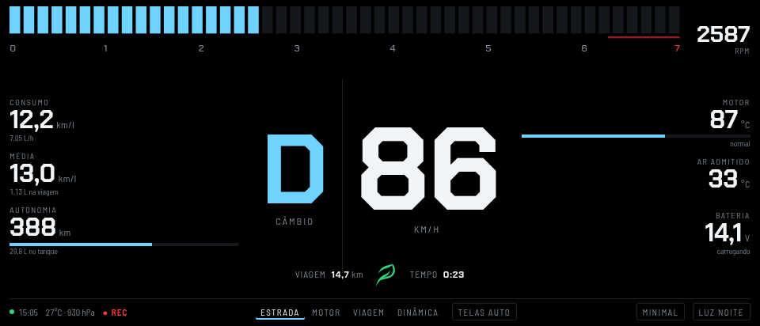 | 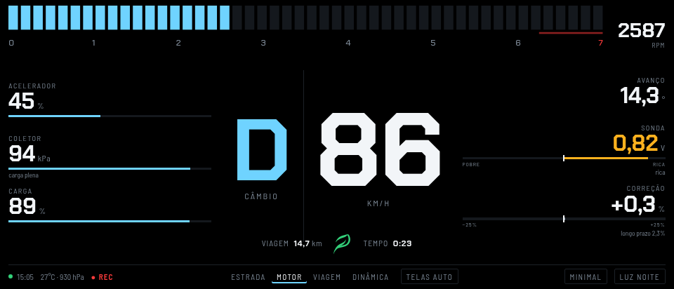 | 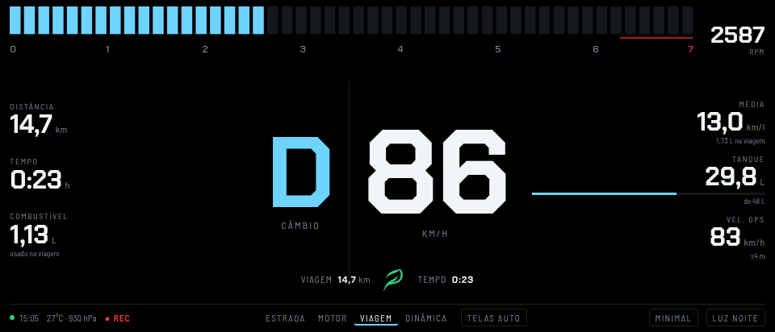 | 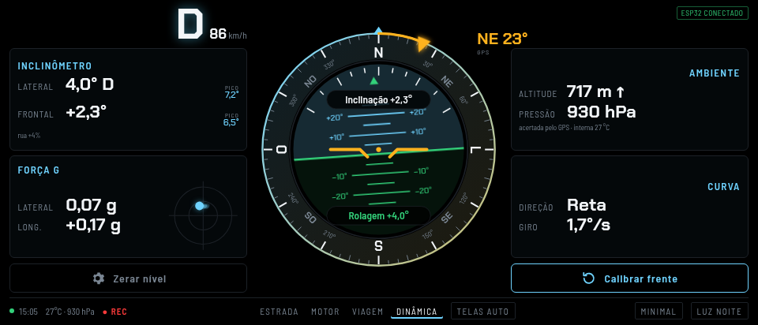 |
| **Capsule** | 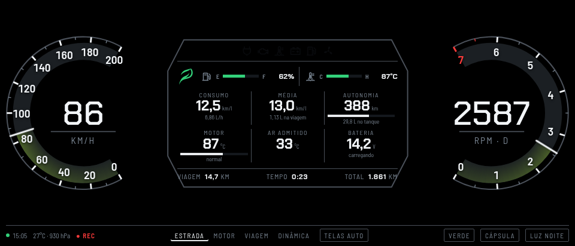 | 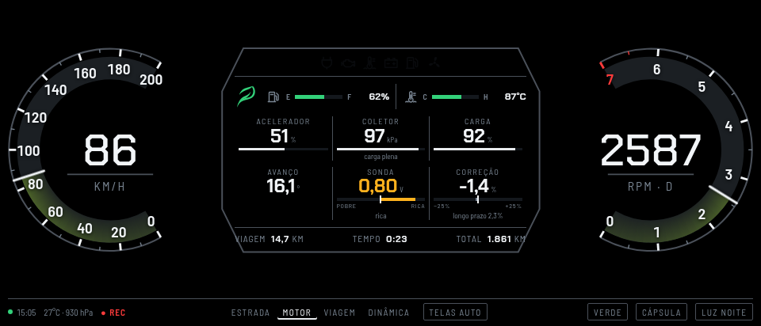 | 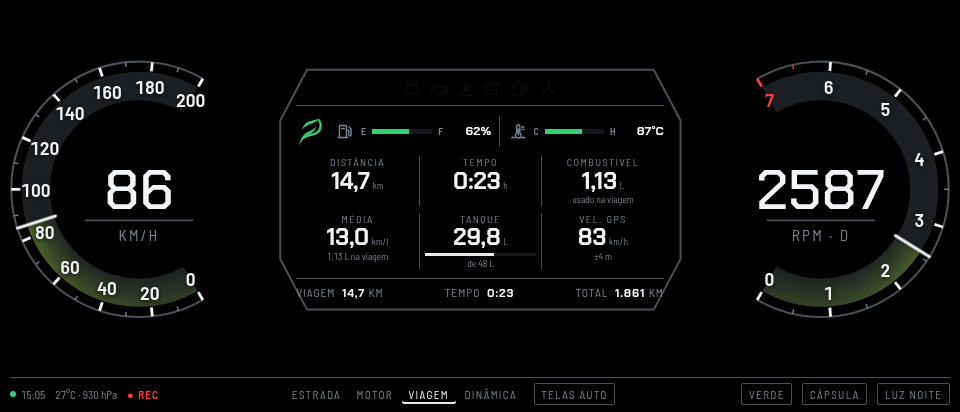 | 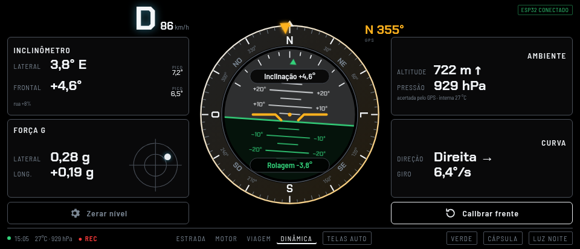 |
| **HUD** | 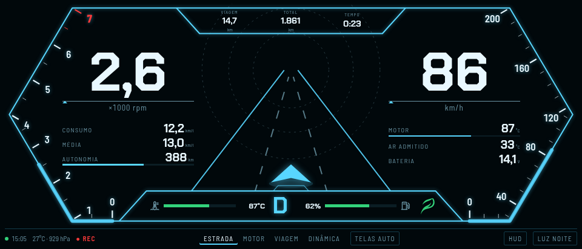 | 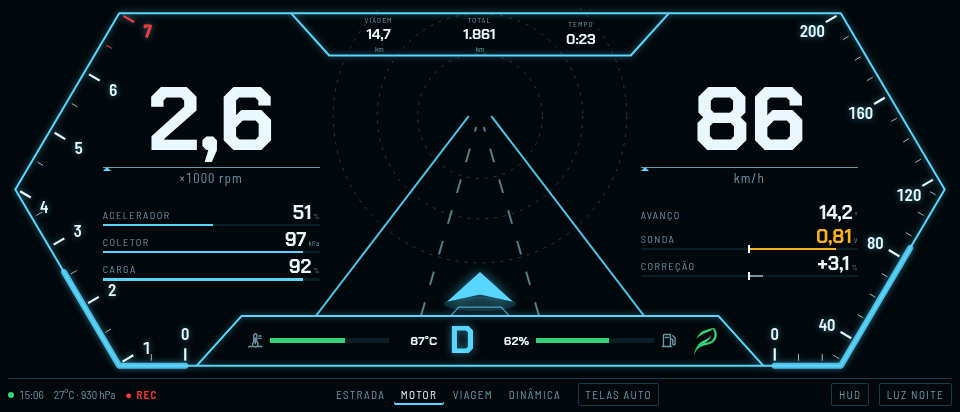 | 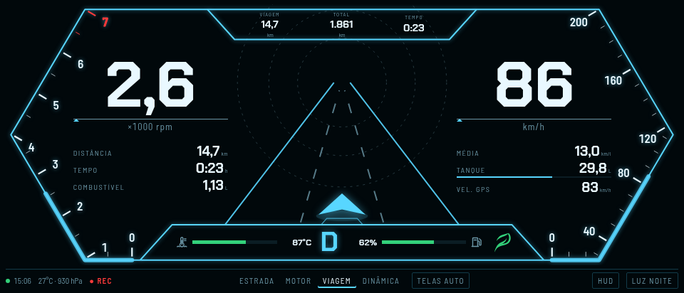 |  |
| **Track** | 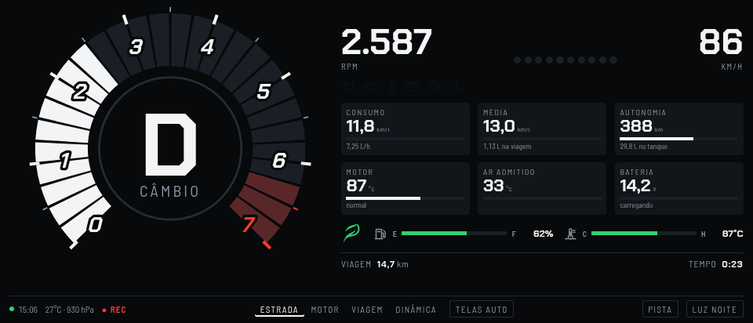 | 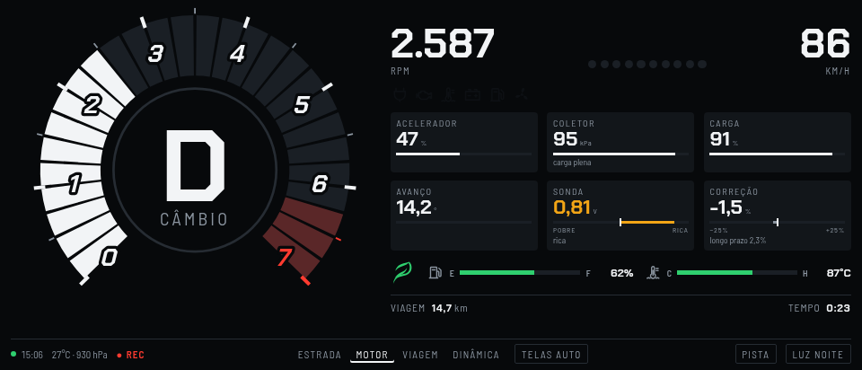 | 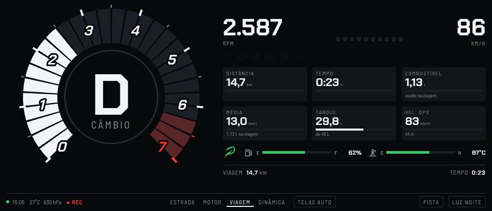 | 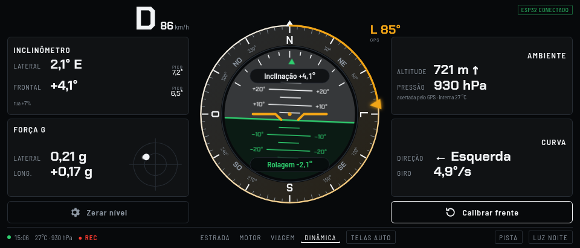 |
| **Classic** | 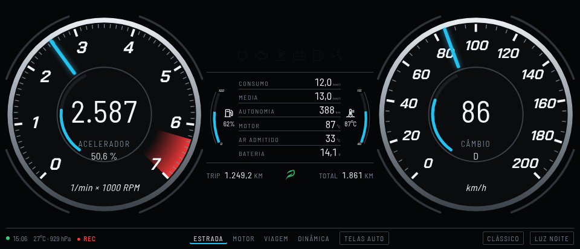 | 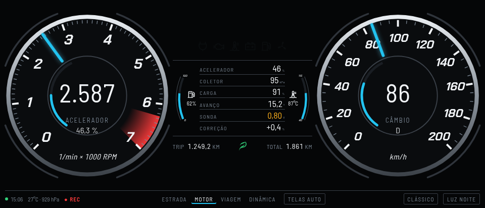 | 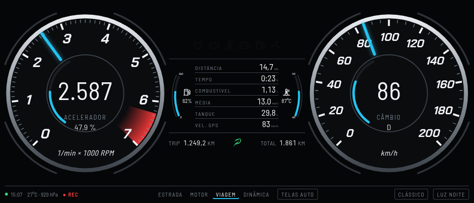 | 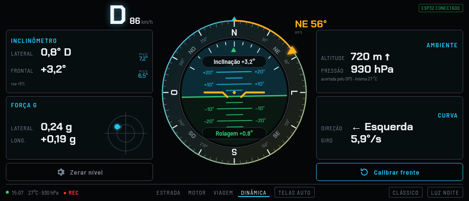 |
| **Horizon** | 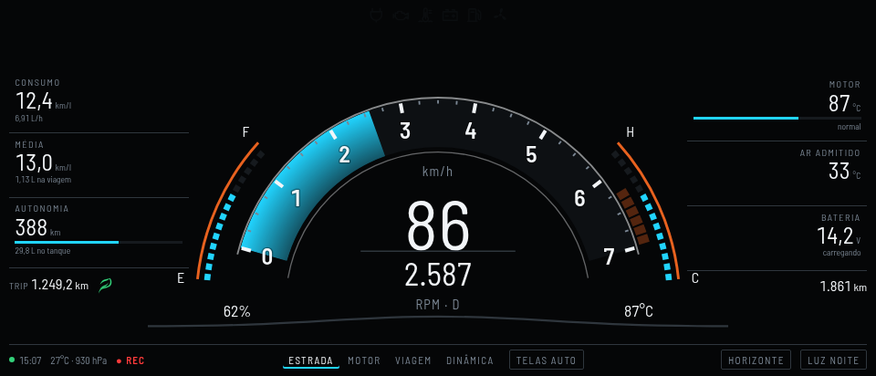 | 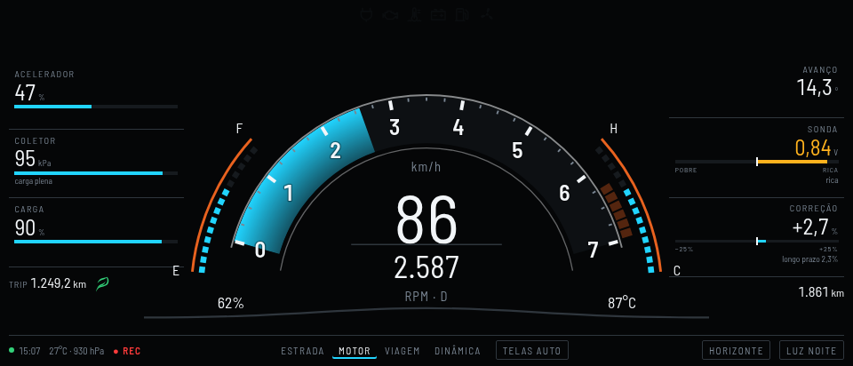 | 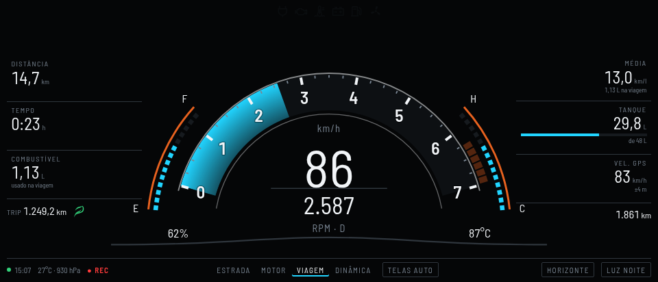 | 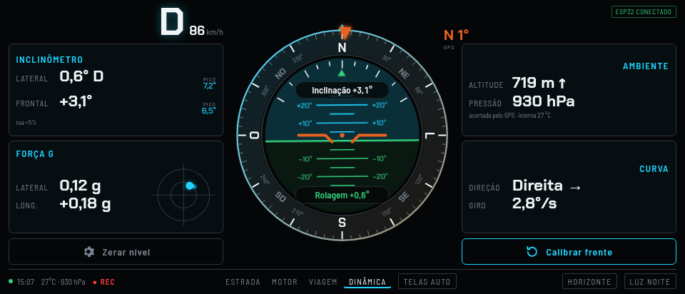 |

## Features

- **Dashboards:** six themes (Minimal, Capsule, HUD, Track, Classic, Horizon) with day/night modes, landscape full screen and four pages: road, engine, trip and **Dynamics** (gear P/D/R, tilt, g-force, compass with artificial horizon, turn rate and altitude, from the ESP32 board's IMU and magnetometer cross-checked with the phone's GPS).
- **Background capture:** a foreground service keeps reading with the screen off. Capture starts automatically when the adapter or the car's head unit connects and resumes after short disconnections.
- **Trip black box:** a local Room/SQLite database with trips, 2-second telemetry samples, trouble codes and freeze frames, plus CSV/GPX export.
- **Fuel log:** real consumption between full tanks, cost per km and monthly spend, and when ethanol pays off in this car. Consumption calibration comes from your own fill-ups.
- **Diagnostics:**
  - readiness monitors and the ECU's own freeze frame (mode 02);
  - a raw diagnostic recorder;
  - a network console that can also tell whether your ELM327 is a clone;
  - for clones without silent mode, passive CAN sniffing with an Arduino + MCP2515 in Listen-Only mode ([guide, in Portuguese](docs/can-escuta.md)).
- **Optional AI assistant:** any OpenAI-compatible API (OpenAI, Claude, Gemini…).
  - Explains trouble codes, analyzes trips and answers questions about the car's history.
  - Only aggregated data leaves the phone (no GPS, VIN or places), and the exact text is shown before the first send.
- **Full backup:** a single .zip with the database, settings and imported profiles.
- **Read-only by design:** only mode 01/03/07/0A/09 queries and adapter AT commands. Nothing is written to the ECU.

## Supporting another car

Start from the generic SAE J1979 profile and follow [docs/criar-perfil.md](docs/criar-perfil.md) (Portuguese). Profiles define:
- init commands and polling lanes;
- formulas over response bytes (`A`, `B`…);
- semantic roles;
- fuel model, thermal bands, gear ratios and alerts.

## Building

JDK 17 and the Android SDK (compileSdk 37, targetSdk 36; AGP 9, Kotlin 2.4, Gradle 9):

```bash
./gradlew :app:testDebugUnitTest :app:lintDebug :app:assembleDebug
python3 -I -m unittest discover -s tools/trip-report -p 'test_*.py'
python3 -I -m unittest discover -s tools/can-capture -p 'test_*.py'
```

CI runs both, plus an emulator smoke test of the R8-optimized build. See [docs/android-auto.md](docs/android-auto.md) for testing on the Desktop Head Unit. Note: since Android Auto 17.7, *Unknown sources* no longer admits sideloaded Car App Library apps, so the APK from Releases does not show up on a real car screen; only the Desktop Head Unit works.

## Contributing

Bug reports, profiles for other cars and pull requests are welcome. See [CONTRIBUTING.md](CONTRIBUTING.md) (in Portuguese; English issues are fine). The app is read-only towards the vehicle: no ECU writes, actuators, code clearing or CAN transmission.

## License

The code is released under the [MIT License](LICENSE).

The **Eletro Info Tecnologia** name, logo and the `[EI]` emblem (the app icon) are trademarks of Eletro Info Tecnologia and are **not** covered by the MIT License. If you publish a modified build of the app, use a different name and icon.
