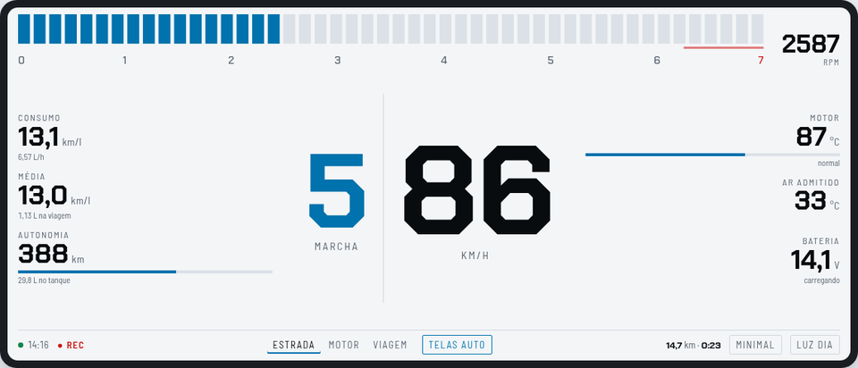
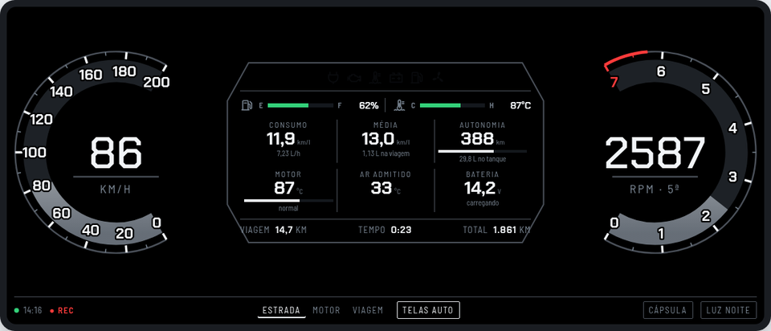
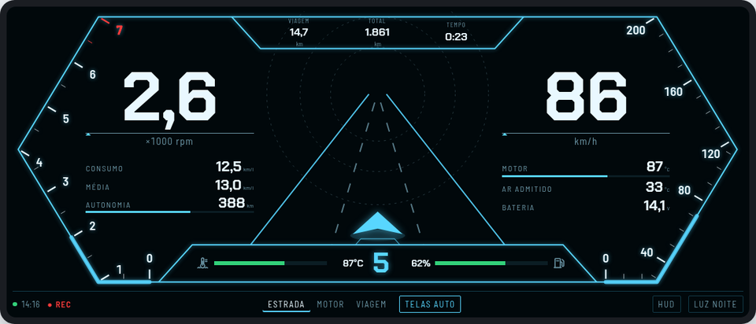

# Universal-OBD-Dashboard

Universal-OBD-Dashboard é uma plataforma de telemetria automotiva de código aberto projetada para Android e Android Auto. O projeto utiliza adaptadores OBD2 (Bluetooth SPP / chip duplo PIC18F25K80) para coletar, calcular e exibir dados do veículo com alta fidelidade, funcionando de forma 100% agnóstica via arquivos de perfil JSON.

*English summary: [README.en.md](README.en.md).*

| Minimal (dia) | Cápsula (noite) | HUD (noite) |
|---|---|---|
|  |  |  |

## Destaques
- **Compatibilidade com Android Auto**: Interface nativa baseada na AndroidX Car App Library.
- **Motor em Segundo Plano**: Coleta ininterrupta de dados e diagnóstico com tela do celular bloqueada (Foreground Service).
- **Caixa Preta de Viagens**: Registro contínuo em banco de dados SQLite local (Trip Computer e logs de DTCs).
- **Perfis Customizáveis**: Configure fórmulas, limites de RPM/temperatura e PIDs específicos por montadora sem alterar o código-fonte.
- **Perfil Uno Vivace Incluso**: Mapeamento completo para Fiat Uno Vivace 1.0 Flex (ECU Magneti Marelli IAW 7GF).

## Hardware Recomendado
- Adaptador OBD2 Bluetooth (SPP) compatível com ELM327, inclusive os clones "v1.5" com PIC18F25K80, usados no desenvolvimento. Adaptadores com chip STN (OBDLink) também funcionam. *Ajustes → Console da rede → Identificar adaptador* mostra o que é o seu.
- Dispositivo Android 8.0+ compatível com Android Auto.
- O app **só faz consultas** ao carro: leituras do modo 01, códigos de falha, identificação e comandos do próprio adaptador. Nada é escrito na ECU.

## Arquitetura

```
 ┌──────────── ObdForegroundService (FGS connectedDevice|location + Partial WakeLock) ────────────┐
 │                                                                                                 │
 │  BluetoothSerialManager ──► CommandQueue (EDF, 1 comando em voo) ──► TelemetryHub (StateFlow)   │
 │        SPP/RFCOMM             alta 100 ms │ média 1,5 s │ sentinela 10 s        │               │
 │                                                                                 ▼               │
 │  FusedLocationProvider ─────────────────────────────────────────────► TelemetryEngine (250 ms) │
 │                                                    consumo · marcha · alertas · energia         │
 │                                                                                 │               │
 │                                                     Room: trips · telemetry_log (2 s) · DTCs    │
 └─────────────────────────────────────────────────────────────────────────────────────────────────┘
          ▲ AutoDisconnectReceiver (ACL)       TelemetryHub ──► TelemetryScreen (Android Auto)
          ▲ DashboardSession (Android Auto)                └──► MainActivity (WebView assets/web)
```

| Pacote | Arquivo | Responsabilidade |
|---|---|---|
| `obd` | `ProfileParser.kt` | Modelo do perfil JSON, validação e **avaliador de fórmulas** (compila para AST uma vez) |
| `obd` | `ElmProtocol.kt` | Parser de respostas ELM327 (single/multi-frame ISO-TP, erros) e decodificador de DTC |
| `obd` | `CommandQueue.kt` | Escalonador das três esteiras sobre o socket SPP |
| `obd` | `BluetoothSerialManager.kt` | Socket RFCOMM, leitura até o prompt `>` e timeouts |
| `telemetry` | `TelemetryHub.kt` / `TelemetryEngine.kt` | Estado compartilhado, consumo, indicador de marcha, alertas, acumulador de viagem |
| `service` | `ObdForegroundService.kt` | Ciclo de vida, reconexão, GPS, máquina de estados de energia, gravação Room |
| `service` | `AutoDisconnectReceiver.kt` | Início/fim automáticos por eventos Bluetooth |
| `car` | `DashboardCarAppService.kt` / `TelemetryScreen.kt` | Android Auto (`GridTemplate`) |
| `db` | `AppDatabase.kt` / `TripDao.kt` / `TelemetryEntity.kt` | Caixa preta SQLite (viagens, telemetria, falhas, abastecimentos, respostas da IA) |
| `bridge` | `AppBridge.kt`, `HistoryBridge.kt`, `FuelBridge.kt`, `DiagnosticsBridge.kt`, `AiBridge.kt` | Pontes JavaScript da tela, uma por assunto (contrato conferido por `BridgeContractTest`) |
| `fuel` | `FuelLog.kt` / `FuelCalibration.kt` | Consumo real entre tanques cheios, mistura etanol/gasolina, calibração |
| `ai` | `AiClient.kt`, `DtcPrompt.kt`, `TripDigest.kt`, `HistoryContext.kt` | Assistente IA opcional (só agregados saem do celular) |
| `backup` | `BackupArchive.kt` / `BackupManager.kt` | Backup completo (.zip) e restauração |
| `diagnostics` | `CanListener.kt`, `AdapterIdentify.kt`, `DiagnosticRecorder.kt` | Console da rede, identificação do adaptador e gravação de diagnóstico |

A tela (`assets/web`) é dividida em `app-core.js` (ponte e utilitários) … `app-main.js` (inicialização), carregados em ordem pelo `index.html`; `WebAssetsTest` confere ids e nomes repetidos.

### Escalonador (CommandQueue)

Cada comando tem `próximo_envio = último_envio + intervalo_da_esteira`. A cada iteração é enviado o comando vencido com o prazo mais antigo (*Earliest-Deadline-First*); empates favorecem a esteira de maior prioridade. Nunca há escrita antes do prompt `>` da resposta anterior, o que evita o `BUFFER FULL` do ELM327.

Um ELM327 via SPP responde tipicamente 10–25 requisições/s. Com 4 PIDs a cada 100 ms (40 req/s) a esteira de alta frequência roda "o mais rápido possível" e o EDF garante que média e sentinela não sofram inanição. Otimizações incluídas:

- `ATS0` (sem espaços) e sufixo de contagem de respostas (`010C1`, `append_response_count`), que faz o ELM devolver sem esperar o timeout;
- descoberta de PIDs suportados (`0100/0120/…`): PIDs ausentes são desativados ou trocados pelo `fallback_command` (ex.: tensão `0142` → `ATRV`);
- modo ocioso: com o veículo parado, as esteiras são desaceleradas (`idle_poll_multiplier`).

### Gerenciamento de energia

| Evento | Ação |
|---|---|
| ACL do adaptador/dispositivo-gatilho conecta | inicia o serviço |
| Sessão do Android Auto criada | inicia o serviço |
| Bluetooth cai e não reconecta (`reconnect_attempts`, padrão 6) | salva a viagem e encerra |
| Adaptador responde mas a ECU não (ignição ainda desligada) | espera até `ignition_wait_s` (5 min) antes de encerrar |
| ECU sem resposta por `ecu_silence_timeout_s` (ignição desligada com adaptador ainda energizado) | salva a viagem e encerra |
| OBD **e** GPS ≤ limiar pelo tempo de *Ajustes → Captura* (5, 15 ou 30 min, ou nunca; padrão 15) | notificação "Continuar / Encerrar" (também no Android Auto); polling e GPS em baixa potência |
| Sem resposta em `idle_confirm_timeout_s` | salva a viagem e encerra |

> **Adaptadores ELM327 são passivos**: o evento `ACL_CONNECTED` só ocorre quando o telefone abre o socket. Para início 100% automático, cadastre em *Ajustes → Dispositivos-gatilho* o nome Bluetooth da multimídia do carro ou use o Android Auto. No Android 12+ o sistema pode bloquear o início a partir de segundo plano; nesse caso aparece uma notificação "Toque para iniciar".

### Exportação de viagens

Na aba *Histórico*, cada viagem tem os botões **CSV** e **GPX**, que abrem o menu de compartilhamento do Android (Drive, e-mail, WhatsApp...).

| Formato | Conteúdo |
|---|---|
| CSV | Uma linha por amostra da caixa preta (2 s): `timestamp_ms`, `time_utc`, colunas fixas (rpm, velocidade OBD/GPS, TPS, MAP, temperaturas, tensão, trims, lambda, consumo, GPS) e uma coluna para cada saída extra do perfil. Vírgula como separador e ponto decimal. |
| GPX 1.1 | Trajeto com `<trkpt>` por amostra com GPS (novo segmento após 30 s sem fix), extensões `obd:speed_kmh`, `obd:rpm`, `obd:coolant_c`, `obd:throttle_pct` e `obd:fuel_lph`, e um `<wpt>` por falha (DTC) com o freeze frame. Abre no Google Earth, Strava, OsmAnd etc. |

O código fica em `export/TripExporter.kt` (Kotlin puro, testado na JVM) e `export/TripExportFiles.kt` (arquivo em `cache/exports`, apagado após 24 h).

### Gravação de diagnóstico

Para testes em veículos novos e para calibração, ative *Ajustes → Gravação de diagnóstico*. A partir da próxima captura, cada sessão gera um arquivo `diag_<data>_<perfil>.jsonl`, com uma linha JSON por evento:

| `type` | Conteúdo |
|---|---|
| `session` | versão do app, perfil, celular/Android, nomes do adaptador |
| `adapter` | versão do ELM, PIDs suportados e desativados |
| `elm` | `cmd`, resposta bruta `rx` (ou `err`), latência `ms` |
| `scan` | início/fim da varredura única da ECU (respostas nas linhas `elm`) |
| `snapshot` | 1×/s: leituras, métricas derivadas, GPS, estado de conexão/energia |
| `status`, `power`, `alert`, `dtcs`, `pid_status`, `error`, `stop` | eventos da sessão |

Em *Ajustes*, cada arquivo tem **Exportar .gz** (menu de compartilhar). Falhas fatais do app ficam em `crash_<data>.txt` na mesma lista. Ocupa cerca de 5–10 MB por hora (bem menos compactado).

### Assistente IA (opcional)

*Ajustes → Assistente IA* liga um botão **Explicar com IA** em cada código de falha, nas falhas ativas e no histórico. O app manda à IA o veículo, o motor/ECU, o código, a descrição do perfil e as leituras do momento da falha (rotação, velocidade, carga, temperatura), e mostra a resposta: significado, causas prováveis, gravidade e o que verificar.

- **Provedores:** qualquer API no formato OpenAI (`POST <endereço>/chat/completions`, chave em `Authorization: Bearer`).

  | Provedor | Endereço |
  |---|---|
  | OpenAI | `https://api.openai.com/v1/` |
  | Claude | `https://api.anthropic.com/v1/` |
  | Gemini | `https://generativelanguage.googleapis.com/v1beta/openai/` |
  | Personalizado | outro endereço `https://` (OpenRouter, Groq…) |

  O nome do modelo é informado pelo usuário. O campo traz um exemplo, mas confira o nome atual na página do provedor.
- **Privacidade:**
  - Nunca saem GPS, trajeto, horário, VIN nem o número da viagem. O lado nativo só aceita uma lista fechada de campos, e um teste garante isso.
  - Antes do primeiro envio, o app mostra o texto exato que vai sair. Depois disso, ele continua disponível em "O que foi enviado".
- **Analisar viagem:** o botão **Analisar com IA** de cada viagem envia um resumo calculado no celular, sem coordenadas, horário nem VIN. O resumo traz:
  - distância, tempos em movimento e parado;
  - faixas de velocidade e rotação e o tempo em cada marcha estimada;
  - consumo em até 8 trechos;
  - temperaturas, tensão e falhas.
- **Perguntar à IA** (aba Histórico): conversa sobre o carro. O contexto é montado no celular:
  - as 40 viagens mais recentes, com data sem horário;
  - os abastecimentos, sem nome do posto nem observações;
  - consumo real, gastos por mês e o ponto de equilíbrio etanol × gasolina;
  - as falhas registradas.
- **Confirmação:** antes do primeiro envio de cada tipo (falha, viagem, pergunta), o app mostra o texto e espera o **Enviar**.
- **Chave de API:**
  - Cifrada com AES-GCM, com a chave no Android Keystore do aparelho.
  - Aparece mascarada e não entra em exportações.
  - Em outro celular, um backup não a revela.
- **Custo e rede:** cada consulta usa créditos da sua conta no provedor. Sem internet, o botão avisa e o resto do app funciona igual.

### Console da rede (escuta CAN)

*Ajustes → Console da rede* abre uma tela tipo terminal que escuta por 60 s o tráfego CAN dos pinos 6/14, somente ouvindo: o ELM327 fica em modo silencioso (`ATCSM1`) e só recebe comandos `AT`. Se o adaptador não aceitar o modo silencioso, a escuta é cancelada. Com *Velocidade: automática*, o app experimenta 500, 250, 125, 100, 83,3, 50 e 33,3 kbps por 4 s cada e escuta na que trouxe mais quadros. No fim, mostra um resumo por ID com os bytes que variaram.

**Identificar adaptador** (no mesmo console) envia só comandos internos do adaptador, nunca ao carro: `ATZ`, `ATI`, `AT@1`, `AT@2`, `ATPPS`, `ATCSM1`, `STI` e `ATRV`. Com as respostas, o app aponta clone de ELM327, chip STN (OBDLink) ou "nenhum sinal de clone". Um adaptador é clone quando declara uma versão que a Elm Electronics nunca lançou (como a v1.5) ou quando diz ser v1.4 ou mais nova sem conhecer `ATCSM`/`ATPPS`. O resultado fica em `diag_<data>_console-identificar.jsonl`.

Cada escuta gera `diag_<data>_console-escuta.jsonl`, com linhas `can` (`l` = quadro bruto, `ms` desde o início), `can_probe`, `can_summary` e `elm`. O arquivo aparece no histórico do console e na lista de arquivos de diagnóstico, com as opções ver, exportar .gz e apagar. Use com a captura encerrada e a ignição ligada.

Se o adaptador for um clone sem `ATCSM`, como o usado no desenvolvimento, a escuta pode ser feita fora do app com um Arduino Uno + MCP2515 em modo Listen-Only, que garante no hardware que nada é transmitido: veja [docs/can-escuta.md](docs/can-escuta.md).

### Continuidade da viagem

Depois de uma **desconexão automática** (ignição desligada, queda de Bluetooth, inatividade sem resposta, app reiniciado pelo sistema), uma captura que começa até **1 hora** depois (ajustável em *Ajustes → Captura*) **continua a mesma viagem**: mesmos totais no histórico, mesmo CSV/GPX e mesmo arquivo de diagnóstico (com um evento `resume`). Encerrar à mão (*Encerrar viagem* no app, na notificação ou no Android Auto, ou *Encerrar agora* na inatividade) faz a próxima captura começar uma viagem nova. A varredura de diagnóstico da ECU roda uma vez por dia por veículo, e *Ajustes → Pronto para viajar* lista as permissões e ajustes de bateria que mantêm a captura e o GPS em segundo plano.

### Painel de instrumentos

A aba **Painel** mostra os instrumentos em três temas, trocados pelo botão no rodapé do painel: **Minimal** (barra de RPM no topo, marcha e velocidade grandes), **Cápsula** (velocímetro e conta-giros de arco, cápsula central com luzes, barras de combustível/temperatura e células) e **HUD** (moldura neon com escalas na borda e estrada animada pela velocidade). Cada tema tem modo dia/noite (automático pelo tema do Android ou pelo horário) e três telas de seis campos (**Estrada**, **Motor**, **Viagem**), trocadas por toque, por deslize ou sozinhas (Viagem quando o carro para). Limites, faixas térmicas, relações de marcha e papéis vêm do perfil JSON, então o painel serve para qualquer veículo.

Com o celular **na horizontal** e o Painel aberto, o app entra em tela cheia; durante a captura, com o Painel aberto, a tela fica ligada. O painel anterior, com todos os sensores, alertas e falhas em lista, continua na aba **Detalhes**. Para avaliar os temas fora do app (simulador ou trecho de viagem real), veja [tools/painel-preview](tools/painel-preview/README.md).

### Detalhes: falhas e monitores de prontidão

A aba **Detalhes** mostra as falhas ativas e os **monitores de prontidão** da ECU: os autodiagnósticos que ela roda sozinha ao dirigir (catalisador, sonda, sistema de combustível, falha de ignição…), vindos dos bytes B–D do PID `0101`. "Em teste" é normal depois de desligar a bateria ou apagar códigos.

Quando surge uma falha nova, o app lê uma vez o **congelamento de quadro gravado pela própria ECU** (modo 02). O resultado aparece no histórico de falhas e entra no "Explicar com IA".

### Abastecimentos

A aba **Abastecimentos** registra cada parada no posto: data e hora, hodômetro, litros, valor pago (ou preço por litro), combustível (gasolina, aditivada/premium, etanol ou mistura), se foi tanque cheio e o posto. Com dois **tanques cheios** com hodômetro, o app mostra o **consumo real** (litros colocados ÷ km rodados), o **custo por km**, o **gasto do mês** e, para cada intervalo, quanto o próprio app tinha estimado, como conferência da calibração. Com tanques cheios de etanol e de gasolina, mostra a partir de que preço o **etanol compensa neste carro**. Registrar um tanque cheio na hora também acerta o nível do tanque e o hodômetro do app.

O card **Calibração do consumo** compara, em cada intervalo entre tanques cheios, os litros reais com o que o app estimou. A estimativa é a integral do consumo gravado no período. Com 3 ou mais intervalos parecidos, o card sugere um fator de correção, que se aplica com um toque e vale por veículo. Intervalos com diferença acima de 25% ficam de fora, por exemplo tanque não completado ou % de etanol errado.

**Exportar CSV** compartilha todos os abastecimentos (`data_hora,hodometro_km,litros,valor_total,preco_litro,combustivel,etanol_pct,tanque_cheio,posto,observacao`); o mesmo formato pode ser importado de um arquivo (**Escolher arquivo .csv**) ou colado em **Importar**, com a opção de substituir todos os registros.

### Backup completo

*Ajustes → Backup completo* gera um `.zip` com o banco (viagens, telemetria, falhas, abastecimentos, respostas da IA), os ajustes e os perfis importados, para guardar ou levar para outro celular. **Restaurar backup** substitui tudo pelo conteúdo do arquivo, migrando o banco se o backup for de uma versão anterior, e recusa backups de versões mais novas. A chave de API da IA não entra no backup. Com esse CSV, `tools/trip-report --fuel-csv` calibra o consumo intervalo a intervalo.

## Perfis JSON

Passo a passo para criar o perfil de outro carro: [docs/criar-perfil.md](docs/criar-perfil.md).

Perfis embarcados ficam em `app/src/main/assets/profiles/`. Perfis importados pela tela *Ajustes* são gravados em `<filesDir>/profiles/` e têm precedência sobre os embarcados com o mesmo `profile_id`.

| Seção | Descrição |
|---|---|
| `init_commands` | Sequência AT enviada após conectar |
| `adapter` | Nomes Bluetooth, timeouts, `append_response_count`, `query_supported_pids` |
| `lanes` | `interval_ms`, `priority` e `throttle_when_idle` de cada esteira |
| `pids.<esteira>[]` | `command`, `formula` (bytes `A`..`Z`) **ou** `outputs[]` (com `hidden` para valores internos), `decoder` (`formula`/`dtc`/`elm_voltage`), `fallback_*` |
| `roles` | Associa papéis semânticos (rpm, speed, map, coolant_temp…) aos ids do perfil |
| `alerts[]` | `condition` (expressão sobre os ids), `level`, `message` com `{id}`, `sustain_ms`, `notify` |
| `thermal`, `dashboard` | Faixas térmicas e limites dos mostradores |
| `fuel` | Tanque, reserva, método (`speed_density`/`maf`), cilindrada, VE, combustíveis flex, corte em desaceleração |
| `shift_indicator` | Velocidades de troca econômica e, opcionalmente, km/h por 1000 RPM de cada marcha |
| `power_management` | Tempos de inatividade, silêncio da ECU e reconexão |

**Fórmulas e condições** aceitam `+ - * / %`, `& | ^ << >>`, comparações, `&& || !`, ternário `c ? a : b` e as funções `min max abs round floor ceil sqrt clamp signed8 signed16`. Nas condições de alerta também estão disponíveis `gps_speed`, `fuel_lph`, `fuel_kml`, `fuel_remaining_l`, `trip_distance_km`, `dtc_confirmed_count` e `dtc_pending_count`. Valor ausente vale `NaN`, então a condição é falsa e não há alerta com dado faltando.

### Perfil Fiat Uno Vivace (IAW 7GF)

- ISO 14230-4 KWP FAST pela linha K (pino 7), confirmado em viagem; `ATSPA5` tenta esse protocolo primeiro; RPM 0–7000 com redline em 6250 RPM e marcha lenta de 815 ± 50 RPM;
- termostato 87 °C, eletroventilador 1ª 97 °C / 2ª 103 °C, crítico > 105 °C;
- troca econômica 1→2 aos 14,8 km/h, 2→3 aos 28,2, 3→4 aos 43,8 e 4→5 aos 61,4 km/h;
- tanque de 48 L, reserva entre 5,5 e 7,5 L (nível estimado por integração do consumo a partir do último "Tanque cheio");
- consumo por *speed-density* (a 7GF não tem MAF), com `volumetric_efficiency` 0,99 calibrada em três abastecimentos reais (consumo medido de 12,5–13,2 km/l na estrada com gasolina).

A luz **STOP** (pressão de óleo) do quadro é ligada direto ao pressostato e não é exposta via OBD. Especificações completas em [docs/veiculos/uno-vivace-7gf.md](docs/veiculos/uno-vivace-7gf.md).

## Compilação

1. Android Studio com suporte ao AGP 9 (2026 ou mais recente), com o JDK 17 ou mais novo.
2. Abra a pasta do projeto; o Studio usa o Gradle do wrapper (9.x). O build é em Kotlin DSL (`*.gradle.kts`), com as versões em `gradle/libs.versions.toml`, e compila com o SDK 37 (`targetSdk` 36).
3. Pela linha de comando: `./gradlew :app:assembleDebug` gera `app/build/outputs/apk/debug/app-debug.apk` (requer `ANDROID_HOME` ou `sdk.dir` em `local.properties`).
4. Testes de unidade do núcleo (fórmulas, parser ELM, DTC, perfis): `./gradlew :app:testDebugUnitTest`.
   Inclui o **simulador de ELM327 em JVM** (`app/src/test/java/.../obd/sim/Elm327Simulator.kt`), que exercita a `CommandQueue` com os perfis reais, em tempo virtual, sem adaptador nem carro: protocolos CAN e K-Line, DTCs, ignição desligada, adaptador travado e clones limitados.

### Testar no Android Auto

O app usa a categoria `androidx.car.app.category.IOT` (não existe categoria de telemetria). Para testar fora da Play Store:
Android Auto → *Configurações* → toque 10× em *Versão* → menu ⋮ → *Configurações do desenvolvedor* → ative **Fontes desconhecidas**. O teste no computador com o *Desktop Head Unit* (DHU) e o que conferir estão em [docs/android-auto.md](docs/android-auto.md). A tela também é testada automaticamente (`TelemetryScreenTest`).

### Integração contínua

Todo push no `master` e todo PR rodam no GitHub Actions ([ci.yml](.github/workflows/ci.yml)):
- `testDebugUnitTest`, `lintDebug` e `assembleDebug`. Os testes incluem Robolectric para a migração do banco, o backup e o Android Auto.
- Os testes das ferramentas `tools/trip-report` (inclusive a paridade do cálculo de consumo com o app) e `tools/can-capture`.
- O job **smoke**, que instala num emulador o APK otimizado pelo R8 (variante `smoke`: release com a chave de debug) e confere que o app abre sem travar.

O Dependabot ([dependabot.yml](.github/dependabot.yml)) avisa semanalmente sobre atualizações. O APK de debug e os relatórios de teste/lint ficam disponíveis como artefatos da execução.

O APK de debug é assinado com a chave fixa `app/debug.keystore` (versionada de propósito; senha `android`). Assim, APKs gerados pelo CI ou por qualquer máquina atualizam uns aos outros sem precisar desinstalar o app, o que apagaria viagens e ajustes.

### Releases

Ao enviar uma tag `vX.Y.Z`, o workflow [release.yml](.github/workflows/release.yml) roda os testes, gera o APK **assinado com a chave de release** e publica em *Releases* com as notas da seção `## [X.Y.Z]` do CHANGELOG. Tags `v0.*` saem como *pre-release*.

**Configuração (uma vez):**
1. No seu computador, rode `scripts/criar-chave-release.sh`. Ele cria `~/.android-keys/universal-obd-release.jks` (fora do repositório) e um `.base64.txt` dela.
2. Em *Settings → Secrets and variables → Actions*, cadastre `RELEASE_KEYSTORE_BASE64`, `RELEASE_STORE_PASSWORD`, `RELEASE_KEY_PASSWORD` e `RELEASE_KEY_ALIAS` (o script mostra os valores).
3. Apague o `.base64.txt` e faça **backup da chave e da senha**: sem elas não é possível publicar atualizações para quem já instalou o app.

**Publicar uma versão:**
1. No CHANGELOG, mova o conteúdo de `[Não lançado]` para `## [X.Y.Z] - AAAA-MM-DD` e atualize os links do rodapé.
2. Em `app/build.gradle.kts`, ajuste `versionName = "X.Y.Z"` e incremente `versionCode`.
3. Commit (`chore: versão X.Y.Z`), depois `git tag vX.Y.Z` e `git push origin master vX.Y.Z`.

O workflow falha com uma mensagem clara se a tag não bater com `versionName`, se a seção do CHANGELOG não existir ou se os secrets não estiverem configurados.

Para assinar um release localmente, defina as mesmas variáveis (`RELEASE_STORE_FILE`, `RELEASE_STORE_PASSWORD`, `RELEASE_KEY_ALIAS`, `RELEASE_KEY_PASSWORD`) no ambiente ou em `~/.gradle/gradle.properties` e rode `./gradlew :app:assembleRelease`. Sem elas o Gradle gera `app-release-unsigned.apk`.

> O APK de release usa outra chave, então não atualiza um APK de debug instalado (nem o contrário): troque de um para o outro desinstalando antes.

## Versionamento

O projeto segue o [Versionamento Semântico](https://semver.org/lang/pt-BR/) (`MAJOR.MINOR.PATCH`) e as mudanças de cada versão ficam no [CHANGELOG.md](CHANGELOG.md).

- **MAJOR**: mudança incompatível no formato dos perfis JSON (`schema_version`) ou no banco Room sem migração.
- **MINOR**: novas funcionalidades, PIDs, perfis de veículo ou telas compatíveis.
- **PATCH**: correções de bugs e ajustes de calibração.

As tags usam o prefixo `v` (ex.: `v0.1.0`) e devem coincidir com `versionName` em `app/build.gradle.kts`. Enquanto a versão for `0.x`, o formato dos perfis ainda pode mudar.

Versão atual: **0.4.0**.

## Licença
Distribuído sob licença MIT.
