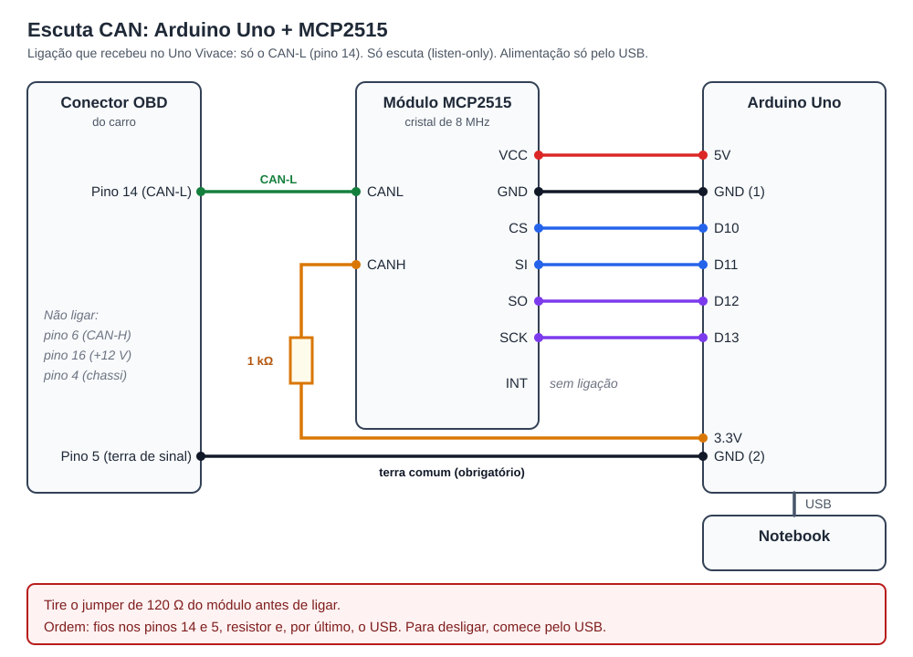
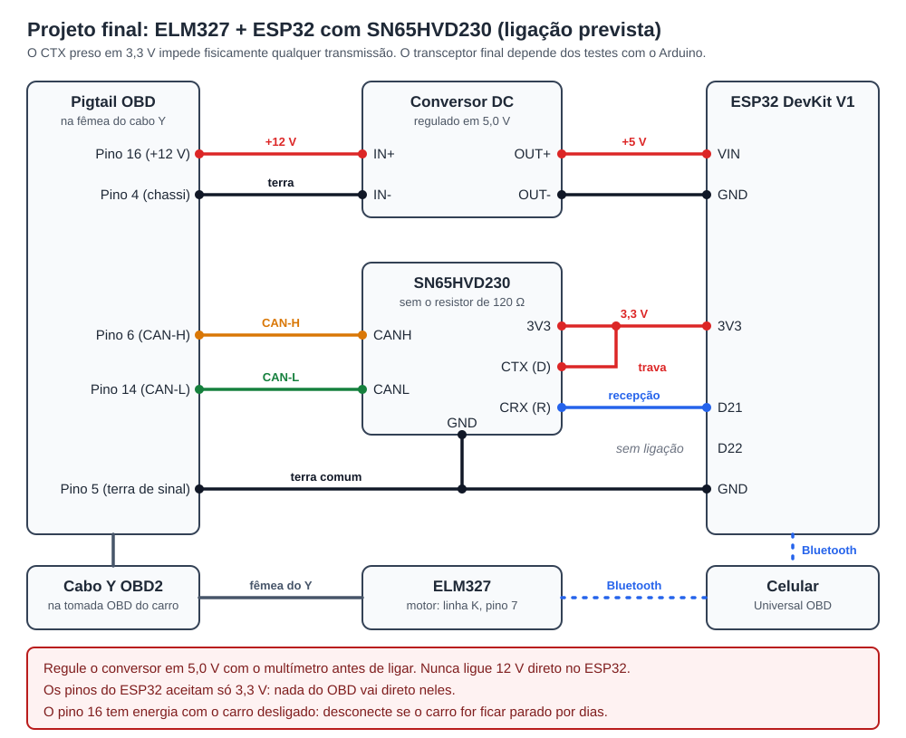

# Escuta passiva da rede CAN (Arduino + MCP2515)

Serve para descobrir o que os módulos do carro transmitem entre si: nível do tanque, hodômetro, setas, portas, luzes do painel. Esses dados não passam pela ECU de motor, então o ELM327 não os lê por consulta OBD.

O projeto só faz **consulta** ao carro. A escuta só é usada com um controlador que garante no hardware que nada é transmitido. O MCP2515 em **modo Listen-Only** é um desses: o chip não envia quadros, ACK nem quadros de erro. O ELM327 clone não serve para isso, porque não tem o modo silencioso (`ATCSM`).

## Material

- Arduino Uno e cabo USB
- Módulo MCP2515 (o comum já traz o transceptor TJA1050). Anote o cristal, gravado no componente metálico: 8 MHz ou 16 MHz.
- Um conector OBD2 macho com fios soltos (pigtail), ou um cabo Y OBD2 para manter o ELM327 ligado ao mesmo tempo
- Notebook com Python 3 e a [Arduino IDE](https://www.arduino.cc/en/software)

## Ligação



| Arduino Uno | MCP2515 |
|---|---|
| 5V | VCC |
| GND | GND |
| D10 | CS |
| D11 | SI (MOSI) |
| D12 | SO (MISO) |
| D13 | SCK |
| (não usado) | INT |

| Conector OBD do carro | Liga em |
|---|---|
| Pino 6 (CAN-H) | Borne CANH do módulo |
| Pino 14 (CAN-L) | Borne CANL do módulo |
| Pino 5 (terra de sinal) | O outro GND livre do Arduino (ao lado do 5V) |

```
OBD 6  ───────────── CANH ┐
OBD 14 ───────────── CANL ├ MCP2515
Arduino GND (1) ──── GND  ┘
Arduino GND (2) ──── OBD 5
```

O **terra é obrigatório**, não serve só para o multímetro. O transceptor lê a diferença entre CAN-H e CAN-L, mas cada fio precisa estar dentro da faixa que ele aceita em relação ao GND dele. Sem o terra comum, o Arduino e o notebook ficam "flutuando" em relação ao carro, e a recepção falha ou chega com erros. Os pinos GND do Arduino são ligados entre si na placa, então qualquer um serve. O borne de parafuso do módulo normalmente só tem CANH e CANL.

Cuidados:
- **Tire o jumper de 120 Ω** do módulo (às vezes marcado J1, perto dos bornes CANH/CANL). A rede do carro já tem a terminação dela. Na rede de carroceria tolerante a falhas não há resistor entre os fios, e um de 120 Ω derrubaria a tensão de repouso.
- **Use o pino 5**, o terra de sinal. O pino 4 é o terra do chassi.
- **Alimentação só pelo USB do notebook.** Nunca ligue o pino 16 (+12 V) nesta montagem.
- **Notebook na bateria durante o teste**, sem o carregador na tomada. Assim o terra da casa não se liga ao terra do carro pelo cabo USB.
- Confira com o multímetro que o pigtail ou o Y ligam de verdade os pinos 5, 6 e 14. Cabos baratos às vezes pulam pinos.
- Com o carro desligado e o Arduino ainda desconectado, meça a tensão dos pinos 6 e 14 em relação ao pino 5:
  - pino 6 perto de 0–1 V e pino 14 perto de 4–5 V: CAN de baixa velocidade tolerante a falhas (ISO 11898-3), típica da carroceria;
  - pino 6 perto de 0 V e pino 14 na tensão da bateria (11–13 V): a mesma rede tolerante a falhas, **dormindo**. Com a ignição desligada, a terminação puxa o CAN-L até a bateria. Ao ligar a ignição, ele volta para 4–5 V;
  - os dois perto de 2,5 V: CAN de alta velocidade.

  Com o multímetro, o pino 6 pode marcar 0 V mesmo com a rede ativa. Os pulsos dominantes são curtos, e o aparelho mostra a média.

  Anote qual apareceu: isso define o transceptor do futuro adaptador ESP32.
- Não estranhe se não der 60 Ω entre CAN-H e CAN-L, como mandam alguns tutoriais. Essa medida só vale para a CAN de alta velocidade.

Ordem de montagem:
1. Meça as tensões com o multímetro.
2. Tire o jumper de 120 Ω.
3. Ligue os três fios (pinos 6, 14 e 5).
4. Conecte o USB do notebook.

Rede deste projeto (Uno Vivace 2012): carroceria nos pinos 6/14, a 50 kbit/s ([notas do veículo](veiculos/uno-vivace-7gf.md)), tolerante a falhas. Medido em relação ao pino 5: pino 6 ≈ 0 V nas quatro situações; pino 14 ≈ 11,3 V com a ignição desligada (dormindo) e ≈ 4,5 V com a ignição ligada ou o motor funcionando.

## Gravar o programa no Arduino

1. Na Arduino IDE, instale a biblioteca **autowp-mcp2515** (*Ferramentas → Gerenciar bibliotecas*).
2. Abra [`firmware/arduino-can-listen/arduino-can-listen.ino`](../firmware/arduino-can-listen/arduino-can-listen.ino).
3. Se o cristal for de 16 MHz, troque `MCP_8MHZ` por `MCP_16MHZ` no topo do arquivo.
4. Grave na placa. **Faça isso com o módulo desligado do carro.**
5. No *Monitor serial* a 500000 baud deve aparecer `# listen-only 50 kbps`. Se aparecer `# ERRO`, o programa parou sem transmitir nada: confira a ligação SPI.

O programa começa em 50 kbit/s. Se nenhum quadro chegar em 3 s, tenta 33,3, 100, 125, 250 e 500, sempre em listen-only, e fixa a primeira velocidade que receber quadros.

## Capturar

O jeito mais simples é a sessão guiada. Ela pede cada passo desta página na ordem, do multímetro à desmontagem, e grava tudo numa pasta:

```bash
python3 tools/can-capture/roteiro.py /dev/ttyACM0 --pasta ~/captura-can
```

A porta pode ser `/dev/ttyUSB0` nos clones com chip CH340 (`ls /dev/ttyACM* /dev/ttyUSB*`). Se der erro de permissão, rode `sudo chmod a+rw /dev/ttyACM0`. Feche o Monitor serial da Arduino IDE antes, porque ele ocupa a porta.

Para gravar à mão: com a montagem pronta, ligue a ignição e só então comece a gravar. Com a ignição desligada e as portas fechadas, a rede da carroceria pode adormecer e ficar muda. Nesse caso, "nada" em todas as velocidades não indica ligação errada: ligue a ignição ou abra uma porta para acordá-la.

```bash
# Grava até Ctrl+C. Tecle Enter com um texto para marcar o momento de cada ação.
python3 tools/can-capture/can_capture.py gravar /dev/ttyACM0 -o captura.log
```

Roteiro sugerido, uma ação de cada vez, com uns 5 s entre elas:

```
seta esquerda    (Enter ao ligar; Enter de novo ao desligar)
seta direita
pisca-alerta
porta do motorista abrir / fechar
farol baixo / alto
freio de mão
partida do motor
```

Para o tanque e o hodômetro, grave alguns minutos andando e outros parado. Para o tanque, grave também logo antes e logo depois de um abastecimento.

## Analisar

```bash
# Um ID por linha: frequência, tamanho e quais bytes mudam
python3 tools/can-capture/can_capture.py resumo captura.log

# O que mudou logo depois de cada marca
python3 tools/can-capture/can_capture.py marcas captura.log --janela 2

# Antes/depois em arquivos separados (ex.: antes e depois de abastecer)
python3 tools/can-capture/can_capture.py comparar antes.log depois.log
```

Os IDs encontrados vão para as [notas do veículo](veiculos/uno-vivace-7gf.md). O passo seguinte é levá-los ao perfil JSON, para o app ler com um adaptador de escuta (ESP32), ao lado do ELM327.

As gravações podem conter o hodômetro e outros dados do carro: não as versione.

## Próxima etapa: adaptador de escuta com ESP32 (em desenvolvimento)

Depois do mapeamento, o plano é um segundo adaptador, fixo no carro, que manda ao app por Bluetooth o que a rede CAN transmite. O ELM327 continua com o motor, os códigos de falha e os monitores. Os dois ficam ligados ao mesmo tempo por um cabo Y.

O ESP32 clássico tem um controlador CAN embutido (TWAI) com modo listen-only. Além disso, o pino de transmissão do transceptor fica preso em 3,3 V, então ele não consegue colocar nenhum bit na rede, mesmo com erro no firmware.

### Lista de compras

| Item | O que procurar | Para quê |
|---|---|---|
| ESP32 DevKit (30 pinos) | "ESP32 DOIT DevKit **ESP32-WROOM-32**", o simples | Lê a CAN e manda ao celular por Bluetooth clássico |
| Módulo SN65HVD230 | "Módulo transceptor CAN SN65HVD230" | Liga o ESP32 aos fios CAN (pinos 6/14), em 3,3 V |
| Step-down 12 V → 5 V | "Mini-560 5V" (saída fixa) ou "LM2596" (ajustável) | Alimenta o ESP32 com os 12 V do pino 16 |
| Cabo Y OBD2 | "Cabo extensor OBD2 Y 1 macho 2 fêmeas" | ELM327 e ESP32 ligados ao mesmo tempo |
| Cabo OBD2 macho com fios soltos | "Pigtail OBD2 macho 16 pinos" | Liga a fêmea do Y ao ESP32 sem cortar nada |
| Cabo micro-USB **de dados** | Cabos só de carga não servem | Gravar o firmware |
| Protoboard, jumpers macho-fêmea e multímetro | — | Montagem de teste e conferência dos pinos do Y |

Evite:
- **ESP32-S3, C3 e C6:** não têm Bluetooth clássico.
- **Placas com bateria 18650:** lítio dentro do carro no sol é risco de incêndio, e a energia já vem da tomada OBD.

### Ligação prevista

No projeto final, o cabo Y mantém os dois adaptadores ligados: o ELM327 lê o motor e o ESP32 escuta a rede CAN. Cada um fala direto com o celular por Bluetooth. O transceptor final depende dos testes com o Arduino.



| SN65HVD230 | Liga em |
|---|---|
| 3V3 / GND | 3,3 V e GND do ESP32; o GND também vai ao pino 5 do OBD |
| CRX (R) | D21 do ESP32 (recepção) |
| CTX (D) | **Fixo no 3,3 V** (trava física: nunca transmite) |
| CANH / CANL | Pinos 6 e 14 do OBD |

Cuidados:
- Tire o resistor de 120 Ω do módulo (marcado "121").
- O step-down vai do pino 16 (+12 V) e do pino 4 ou 5 (terra) ao VIN/GND do ESP32. Nunca ligue 12 V direto no ESP32.
- O pino 16 tem energia com o carro desligado: desconecte o adaptador se o carro for ficar parado por dias.
