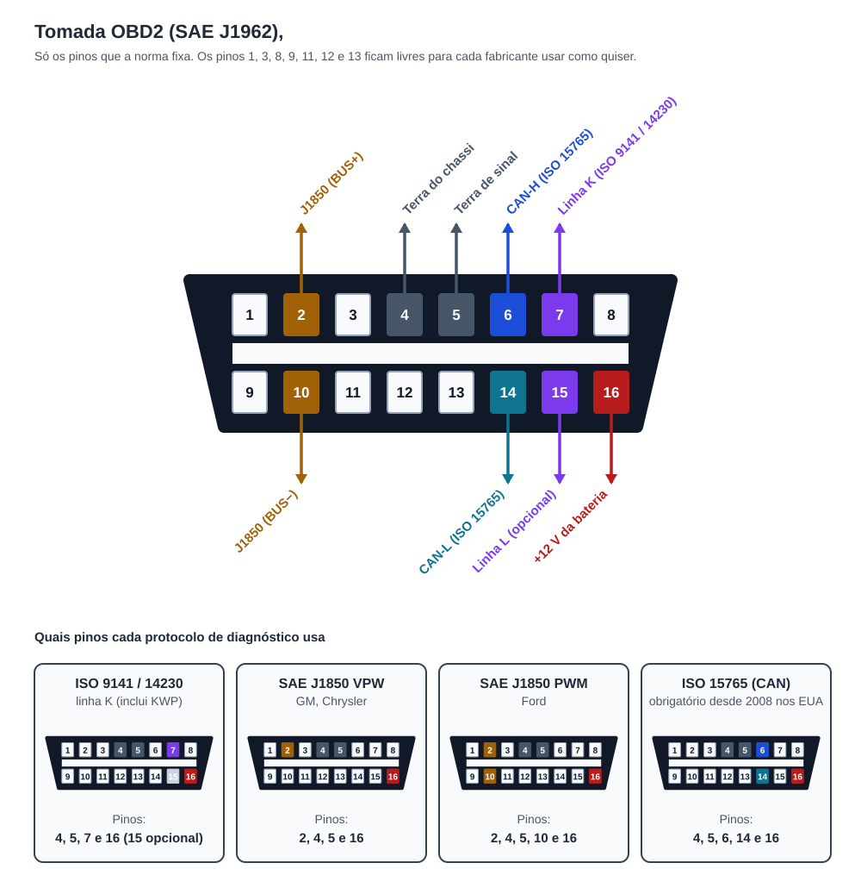

# Escuta passiva da rede CAN

Serve para descobrir o que os módulos do carro transmitem entre si, como nível do tanque, hodômetro e luzes do painel. Esses dados nem sempre passam pela ECU de motor, então o ELM327 pode não lê-los por consulta OBD.

**O ELM327 é a base do app em qualquer carro:** o conector OBD é padrão e o adaptador encontra o protocolo sozinho. **A escuta com ESP32 é um extra por modelo.** A rede, a ligação e os sinais mudam de um carro para outro, e cada veículo mapeado tem a sua pasta em [`veiculos/`](../veiculos/README.md).

O projeto só faz **consulta** ao carro. A escuta só é usada com um controlador que garante no hardware que nada é transmitido, como o MCP2515 em Listen-Only ou o ESP32 em listen-only com o TX do transceptor preso no nível recessivo. O ELM327 clone não serve para isso quando não tem o modo silencioso (`ATCSM`).

## 1. Identifique a rede



A norma só fixa os pinos coloridos; os outros (1, 3, 8, 9, 11, 12 e 13) cada fabricante usa como quiser, então confira no manual do seu carro antes de ligar qualquer coisa neles.

Com o carro desligado e nada conectado, meça a tensão dos pinos 6 e 14 em relação ao pino 5, o terra de sinal:

| Pino 6 | Pino 14 | O que indica |
|---|---|---|
| Perto de 2,5 V | Perto de 2,5 V | CAN de alta velocidade |
| Perto de 0–1 V | Perto de 4–5 V | CAN de baixa velocidade tolerante a falhas (ISO 11898-3), típica da carroceria |
| Perto de 0 V | Na tensão da bateria | A mesma rede tolerante a falhas, dormindo. Volta para 4–5 V ao ligar a ignição |

Repita com a ignição ligada. Se não houver terminal nesses pinos, esta escuta não se aplica ao conector, e a rede pode estar em outros pinos, como 1/9.

## 2. Ligue conforme o seu carro

Primeiro procure o seu modelo em [`veiculos/`](../veiculos/README.md). Se ele não estiver lá, a tentativa inicial é a ligação direta, em listen-only:

| Conector OBD | Módulo transceptor |
|---|---|
| Pino 6 (CAN-H) | CANH |
| Pino 14 (CAN-L) | CANL |
| Pino 5 (terra de sinal) | GND comum com o microcontrolador |

Cuidados em qualquer carro:
- **Terra comum é obrigatório.** Sem ele, a recepção falha ou chega com erros.
- **Use o pino 5**, e não o 4, para o terra do sinal.
- **Confira se o módulo tem terminação de 120 Ω ligada.** A rede do carro já tem a terminação dela. Meça antes, com o módulo fora do carro e o multímetro em Ω entre CANH e CANL. Só retire se der cerca de 120 Ω. Se der bem mais, ou circuito aberto, o resistor "121" que aparece na placa não está ligado entre os dois bornes e deve ficar onde está: tirá-lo à toa pode danificar a placa.
- **Não ligue o pino 16 (+12 V)** em montagens alimentadas pelo USB.
- **Nunca coloque a saída de 5 V do transceptor direto no ESP32**, que trabalha em 3,3 V.
- Confira com o multímetro se o cabo liga mesmo os pinos usados. Cabos baratos às vezes pulam pinos.

Se a rede estiver silenciosa com a ligação certa, ligue a ignição ou abra uma porta para acordá-la. A rede da carroceria pode dormir.

## 3. Grave o firmware

Faça isso com o módulo desligado do carro.

- [`firmware/arduino-can-listen`](../firmware/arduino-can-listen/README.md): Arduino Uno + MCP2515. Busca a velocidade sozinho.
- [`firmware/esp32-can-listen`](../firmware/esp32-can-listen/README.md): ESP32 clássico. A velocidade é fixa no código.

## 4. Capture

### Com o app e o ESP32: Roteiro de captura

Com o ESP32 escolhido em Ajustes → Escuta CAN e a **Gravação de diagnóstico** ligada, o app tem uma tela guiada: Ajustes → Gravação de diagnóstico → **Abrir roteiro de captura**. Ela serve a qualquer veículo:

- **Passos comuns a quase todo carro:** portas, porta-malas, capô, cintos, pedais, freio de mão, ré, luzes, setas, limpadores, travas, vidros, ventilação, ar-condicionado, desembaçador, direção, rotações fixas, indicador de economia e eletroventilador. O que o carro não tiver, pule.
- **Ritmo:** início manual; depois o app fala e vibra a cada "liga" e "desliga" (em geral 10 s cada, 3 vezes) e encerra o passo sozinho.
- **Marcas:** cada mudança vira uma marca no arquivo de diagnóstico, no mesmo relógio dos quadros do ESP32 e do ELM327. No fim do passo, a tela mostra a hora e as leituras do momento, e aceita uma observação.
- **Segurança:** os passos só rodam com o carro parado e a captura gravando. A tela mantém a captura viva (o aviso de parada longa não interrompe o passo) e a tela do celular ligada.

O roteiro genérico fica em [`capture-scripts/generic.json`](../app/src/main/assets/capture-scripts/generic.json). Um perfil pode trazer o próprio roteiro em `capture-scripts/<profile_id>.json` (ver [criar-perfil.md](criar-perfil.md)).

Para analisar, exporte o .gz em Ajustes → Gravação de diagnóstico e rode:

```bash
python3 tools/can-capture/roteiro_app.py diag_….jsonl.gz [--passo door_driver]
```

Para cada passo, a análise mostra os bits que acompanharam todas as vezes "liga" e "desliga", os bytes que mudaram entre as fases (rotações) e o que mudou em volta de cada toque (eletroventilador).

### Com o notebook e o Arduino

O jeito mais simples é a sessão guiada:

```bash
python3 tools/can-capture/roteiro.py /dev/ttyACM0 --pasta ~/captura-can
```

A lista de conferência da montagem no roteiro descreve hoje a ligação do Uno Vivace. Em outro carro, siga a ligação do seu veículo.

A porta pode ser `/dev/ttyUSB0` nos clones com chip CH340 (`ls /dev/ttyACM* /dev/ttyUSB*`). Se der erro de permissão, rode `sudo chmod a+rw /dev/ttyACM0`. Feche o Monitor serial da Arduino IDE antes, porque ele ocupa a porta.

Para gravar à mão, ligue a ignição e só então comece:

```bash
# Grava até Ctrl+C. Tecle Enter com um texto para marcar o momento de cada ação.
python3 tools/can-capture/can_capture.py gravar /dev/ttyACM0 -o captura.log
```

Faça uma ação de cada vez, com uns 5 s entre elas: setas, pisca-alerta, portas, faróis, freio de mão e partida do motor. Para o tanque e o hodômetro, grave alguns minutos andando e outros parado. Para o tanque, grave também logo antes e logo depois de um abastecimento.

## 5. Analise

```bash
# Um ID por linha: frequência, tamanho e quais bytes mudam
python3 tools/can-capture/can_capture.py resumo captura.log

# O que mudou logo depois de cada marca
python3 tools/can-capture/can_capture.py marcas captura.log --janela 2

# Gravação de ações do roteiro: o que mudou de uma leitura para a seguinte em cada teste
python3 tools/can-capture/can_capture.py leituras acoes.log

# Antes/depois em arquivos separados (ex.: antes e depois de abastecer)
python3 tools/can-capture/can_capture.py comparar antes.log depois.log
```

Os sinais encontrados vão para a pasta do veículo. As gravações podem conter o hodômetro e outros dados do carro: não as versione.
