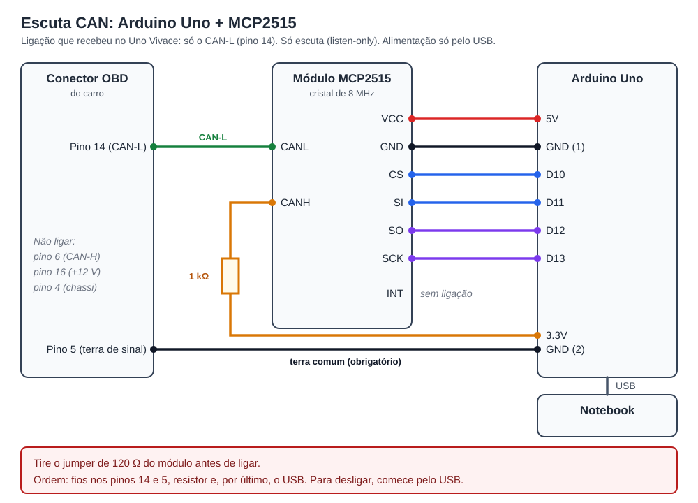
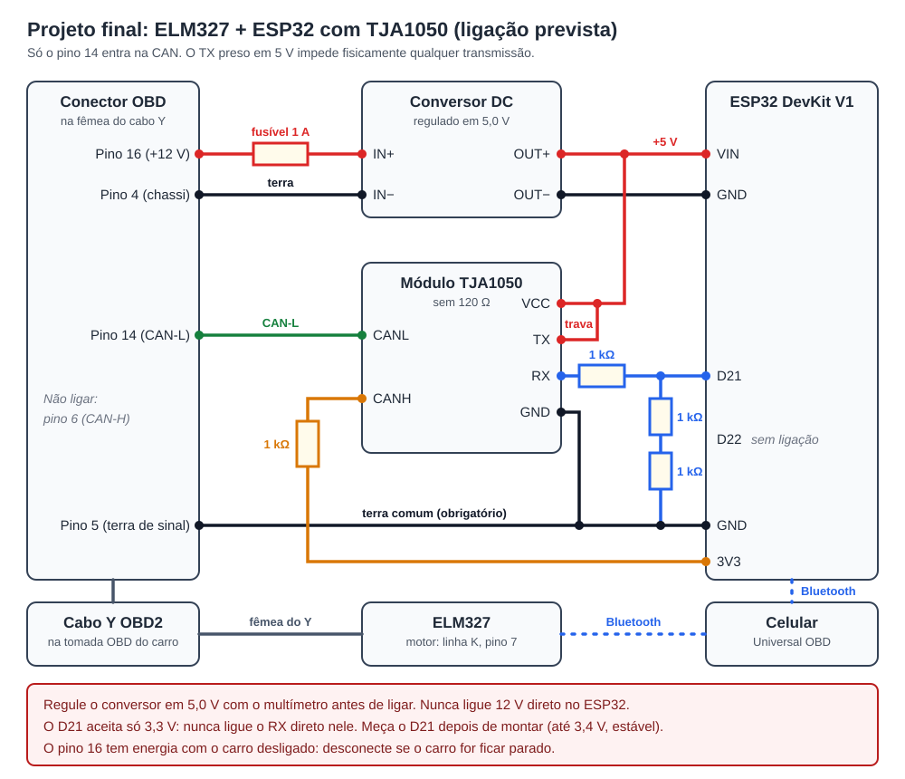
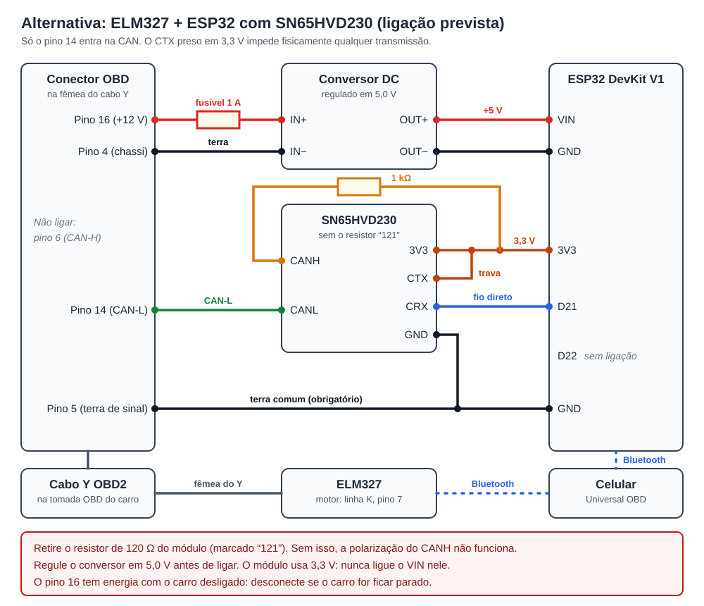

# Fiat Uno Vivace 2012: ligação da escuta CAN

Esta ligação vale **só para este carro**. A explicação geral da escuta, a gravação do firmware e a análise estão em [docs/can-escuta.md](../../docs/can-escuta.md). Em outro veículo, comece pelo [guia da pasta de veículos](../README.md).

Situação em 04/11/2026:
- A recepção foi confirmada no carro com o Arduino + MCP2515 e com o ESP32 + TJA1050, usando só o pino 14.
- O ELM327 e o ESP32 funcionaram juntos em duas viagens, sem cabo Y, pela [ligação por pinos](#elm327-e-esp32-juntos-sem-cabo-y).
- A montagem final (alimentação fixa pelo conversor) e o SN65HVD230 ainda não foram testados.

## Teste com Arduino Uno + MCP2515

Material: Arduino Uno e cabo USB, módulo MCP2515 com TJA1050, resistor de 1 kΩ e conector OBD2 macho com fios soltos.



| Arduino Uno | MCP2515 |
|---|---|
| 5V | VCC |
| GND | GND |
| D10 | CS |
| D11 | SI (MOSI) |
| D12 | SO (MISO) |
| D13 | SCK |
| (não usado) | INT |

| Conector OBD do carro | Liga em |
|---|---|
| Pino 14 (CAN-L) | Borne CANL do módulo |
| Pino 5 (terra de sinal) | O outro GND livre do Arduino (ao lado do 5V) |
| Pino 6 (CAN-H) | Sem ligação |
| (resistor de 1 kΩ) | Entre o borne CANH do módulo e o pino 3.3V do Arduino |

```
OBD 14 ───────────── CANL ┐
Arduino 3.3V ─ 1 kΩ ─ CANH ├ MCP2515
Arduino GND (1) ──── GND  ┘
Arduino GND (2) ──── OBD 5
```

**Por que só o CAN-L:** no Uno Vivace, o pino 6 fica praticamente em 0 V e o sinal só aparece no pino 14. Ligando os dois fios ao TJA1050, um receptor diferencial, a diferença nunca passa do limite dele, e nenhum quadro chega. O resistor dá ao CANH uma referência fixa: a diferença fica em cerca de −1,2 V em repouso e +1,9 V nos bits dominantes. O módulo continua em listen-only. 

O **terra é obrigatório**, não serve só para o multímetro. O transceptor lê a diferença entre CAN-H e CAN-L, mas cada fio precisa estar dentro da faixa que ele aceita em relação ao GND dele. Sem o terra comum, o Arduino e o notebook ficam "flutuando" em relação ao carro, e a recepção falha ou chega com erros. Os pinos GND do Arduino são ligados entre si na placa, então qualquer um serve. O borne de parafuso do módulo normalmente só tem CANH e CANL.

Cuidados:
- **Confira a terminação de 120 Ω** do módulo (às vezes um jumper J1, perto dos bornes CANH/CANL, ou um resistor marcado "121"). A rede do carro já tem a terminação dela. Meça antes, com o módulo fora do carro e o multímetro em Ω entre CANH e CANL. Só retire se der cerca de 120 Ω. Se der bem mais, ou circuito aberto, o resistor "121" que aparece na placa não está ligado entre os dois bornes e deve ficar onde está: tirá-lo à toa pode danificar a placa. Na rede de carroceria tolerante a falhas não há resistor entre os fios, e um de 120 Ω derrubaria a tensão de repouso.
- **Use o pino 5**, o terra de sinal. O pino 4 é o terra do chassi.
- **Alimentação só pelo USB do notebook.** Nunca ligue o pino 16 (+12 V) nesta montagem.
- **Notebook na bateria durante o teste**, sem o carregador na tomada. Assim o terra da casa não se liga ao terra do carro pelo cabo USB.
- Confira com o multímetro que o pigtail ou o Y ligam de verdade os pinos 5, 6 e 14. Cabos baratos às vezes pulam pinos.
- Com o carro desligado e o Arduino ainda desconectado, meça a tensão dos pinos 6 e 14 em relação ao pino 5:
  - pino 6 perto de 0–1 V e pino 14 perto de 4–5 V: CAN de baixa velocidade tolerante a falhas (ISO 11898-3), típica da carroceria;
  - pino 6 perto de 0 V e pino 14 na tensão da bateria (11–13 V): a mesma rede tolerante a falhas, **dormindo**. Com a ignição desligada, a terminação puxa o CAN-L até a bateria. Ao ligar a ignição, ele volta para 4–5 V;
  - os dois perto de 2,5 V: CAN de alta velocidade.

  O significado das tensões está no [guia geral](../../docs/can-escuta.md#1-identifique-a-rede).
- Não estranhe se não der 60 Ω entre CAN-H e CAN-L, como mandam alguns tutoriais. Essa medida só vale para a CAN de alta velocidade.

Ordem de montagem:
1. Meça as tensões com o multímetro.
2. Meça entre CANH e CANL. Só se der cerca de 120 Ω, abra o jumper ou retire o resistor.
3. Ligue os fios dos pinos 14 e 5 e o resistor.
4. Conecte o USB do notebook.

Rede deste carro: carroceria nos pinos 6/14, a 50 kbit/s ([notas do veículo](README.md)), tolerante a falhas. Medido em relação ao pino 5: pino 6 ≈ 0 V nas quatro situações; pino 14 ≈ 11,3 V com a ignição desligada (dormindo) e ≈ 4,5 V com a ignição ligada ou o motor funcionando.

## Lista de compras do adaptador com ESP32

| Item | O que procurar | Para quê |
|---|---|---|
| ESP32 DevKit (30 pinos) | "ESP32 DOIT DevKit **ESP32-WROOM-32**", o simples | Lê a CAN e manda ao celular por Bluetooth clássico |
| Módulo TJA1050 | "Módulo transceptor CAN TJA1050" | Liga o ESP32 ao CAN-L (pino 14), em 5 V. Aguenta ±27 V nos pinos da rede |
| Resistores | Quatro de 1 kΩ | Polarização do CANH e divisor do RX |
| Fusível e suporte | Fusível de vidro 5 × 20 mm de 1,5 A e porta-fusível para placa "AS-06" com tampa (5 × 20, 2 pinos a 20,2 mm) | Protege a placa no fio do pino 16; o suporte vai soldado na placa ([placa/](placa/README.md)) |
| Step-down 12 V → 5 V | "RT8272", "Mini-560 5V" (saída fixa) ou "LM2596" (ajustável) | Alimenta o ESP32 com os 12 V do pino 16 |
| Cabo Y OBD2 | "Cabo extensor OBD2 Y 1 macho 2 fêmeas" | ELM327 e ESP32 ligados ao mesmo tempo |
| Cabo OBD2 macho com fios soltos | "Pigtail OBD2 macho 16 pinos" | Liga a fêmea do Y ao ESP32 sem cortar nada |
| Barras de pinos e conector | Barra de pinos **fêmea** 1 × 20 (2,54 mm, umas 3): 2 pedaços de 15 para o ESP32, 4 para o TJA1050 (ou 6 para o SN65HVD230), 3 e 2 para o RT8272. Barra **macho** 1 × 40: 4 + 4 dos conectores dos sensores e 2 do CAN do TJA1050. Um conector **Dupont fêmea de 2 vias** com fios (ou um jumper fêmea-fêmea cortado) | Os módulos encaixam e saem sem solda ([placa/](placa/README.md)) |
| Cabo micro-USB **de dados** | Cabos só de carga não servem | Gravar o firmware |
| Protoboard, jumpers macho-fêmea e multímetro | — | Montagem de teste e conferência dos pinos do Y |
| Sensor de pressão e temperatura (opcional) | **BMP390** (recomendado) ou **BMP180** (alternativa, o que está ligado hoje) | Pressão do ar e temperatura da cabine: carga do motor com a pressão ao vivo, vácuo do coletor, checagem do sensor MAP e altitude. Entra no I2C, SDA no D25 e SCL no D26 ([firmware](../../firmware/esp32-can-listen/README.md#sensor-bmp180-opcional)) |
| Acelerômetro e giroscópio, eixos XYZ (opcional) | **LSM6DS3** (recomendado) ou **BMI160** (alternativa) | Força G (frenagem, arrancada e curvas), inclinação da rua, buracos e impactos, e acordar o ESP32 pela vibração. Vai num cabo próprio, no mesmo I2C, preso firme no carro e alinhado com ele ([placa/](placa/README.md)). O módulo de 13 × 18 mm tem regulador (VIN em 5 V); CS no 3V3 e SA0 no GND. O firmware 1.3 lê o sensor, e o app mostra os valores na tela Movimento |

Evite:
- **ESP32-S3, C3 e C6:** não têm Bluetooth clássico.
- **Placas com bateria 18650:** lítio dentro do carro no sol é risco de incêndio, e a energia já vem da tomada OBD.

## Teste de recepção com ESP32 + TJA1050

O programa é o [`firmware/esp32-can-listen`](../../firmware/esp32-can-listen/README.md). Este teste usa um módulo TJA1050 sem resistor de 120 Ω (medindo em Ω entre CANH e CANL, deve dar bem acima de 120 Ω) e o ESP32 alimentado pelo USB. Foi aprovado no carro em 01/11/2026, sem erros de CAN:

| Módulo TJA1050 | Liga em |
|---|---|
| VCC | VIN do ESP32 (5 V do USB) |
| GND | GND do ESP32 |
| TX | VIN do ESP32 (trava física: nunca transmite) |
| RX | Resistor de 1 kΩ até o D21 do ESP32 e dois de 1 kΩ em série do D21 ao GND |
| CANL | Pino 14 do OBD |
| CANH | Resistor de 1 kΩ até o 3V3 do ESP32 |

O GND do ESP32 também vai ao pino 5 do OBD. O D22 e os pinos 6 e 16 do OBD ficam sem ligação. Nunca ligue o RX direto no D21: a saída de 5 V pode danificar o ESP32.

Depois, grave pelo mesmo roteiro: `python3 tools/can-capture/roteiro.py /dev/ttyUSB0 --pasta ~/captura-can`, opção 4.

## Ligação prevista

No projeto final, o cabo Y mantém os dois adaptadores ligados: o ELM327 lê o motor e o ESP32 escuta a rede CAN. Cada um fala direto com o celular por Bluetooth. A alimentação do ESP32 pelo pino 16 ainda não foi testada no carro.

### ELM327 e ESP32 juntos sem cabo Y

Testado em 04/11/2026, com o ESP32 alimentado pelo USB:

| Adaptador | Pinos ligados ao carro | Pinos isolados |
|---|---|---|
| ELM327 | 4, 5, 7 e 16 | 6 e 14: clones costumam ter 120 Ω entre eles |
| ESP32 + TJA1050 | 14 (CAN-L) e 5 (terra de sinal) | todos os outros |

- O app conecta os dois ao mesmo tempo: o ELM327 em Ajustes → Adaptador e o ESP32 em Ajustes → Escuta CAN.
- O ESP32 aceita um cliente Bluetooth por vez. Feche outros apps de terminal antes de capturar.
- Resultado da comparação entre as duas fontes: [notas do carro](README.md#rede-do-painel-pinos-614-pesquisa-de-24102026).



| Módulo TJA1050 | Liga em |
|---|---|
| VCC | OUT+ do conversor e VIN do ESP32 (5 V) |
| GND | GND do ESP32 |
| TX | **Fixo nos 5 V** (trava física: nunca transmite) |
| RX | Resistor de 1 kΩ até o D21 do ESP32 e dois de 1 kΩ em série do D21 ao GND |
| CANL | Pino 14 do OBD |
| CANH | Resistor de 1 kΩ até o 3V3 do ESP32 |

| Conector OBD | Liga em |
|---|---|
| Pino 16 (+12 V) | Fusível de 1,5 A e IN+ do conversor |
| Pino 4 (chassi) | IN− do conversor |
| Pino 5 (terra de sinal) | GND do ESP32 |
| Pino 14 (CAN-L) | CANL do módulo |
| Pino 6 (CAN-H) | Sem ligação |

Cuidados:
- Meça em Ω entre CANH e CANL: deve dar bem acima de 120 Ω. Se der cerca de 120 Ω, o resistor de terminação está ligado e precisa sair. Se der bem mais, não mexa no módulo, mesmo que haja um resistor "121" na placa.
- Solde a montagem. Um mau contato no divisor faz o D21 passar de 3,3 V. Depois de soldar, meça o D21: até 3,4 V, estável.
- Regule o conversor em 5,0 V antes de ligar o ESP32, e deixe o EN dele sem ligação. Nunca ligue 12 V direto no ESP32.
- O pino 16 tem energia com o carro desligado. O firmware 1.1 entra em descanso depois de 2 min de rede parada e acorda com a rede, gastando em torno de 10 mA nesse tempo ([modo descanso](../../firmware/esp32-can-listen/README.md#modo-descanso)). Com o firmware 1.0, desconecte o adaptador ao estacionar.

## Alternativa com SN65HVD230

Este módulo funciona em 3,3 V, então dispensa o divisor do RX. Em troca, aceita menos tensão nos pinos da rede: −4 a 16 V, contra ±27 V do TJA1050. Esta ligação ainda não foi testada.



| SN65HVD230 | Liga em |
|---|---|
| 3V3 | 3V3 do ESP32 |
| GND | GND do ESP32 |
| CTX | **Fixo no 3,3 V** (trava física: nunca transmite) |
| CRX | D21 do ESP32, com fio direto |
| CANL | Pino 14 do OBD |
| CANH | Resistor de 1 kΩ até o 3V3 do ESP32 |

Os desenhos da placa e o modelo 3D desta versão estão em [placa/](placa/README.md#versão-alternativa-com-o-sn65hvd230). A alimentação e os pinos do OBD são os mesmos da ligação com o TJA1050. Antes de ligar, meça em Ω entre CANH e CANL. O módulo costuma ter um resistor marcado "121" (120 Ω), mas ele só precisa sair se a medida der cerca de 120 Ω. Se der bem mais, ele não está ligado entre os bornes e fica onde está.
