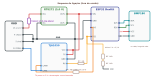
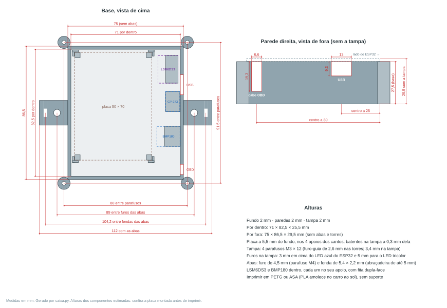
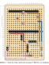
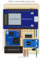
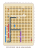
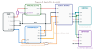
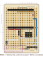
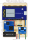
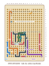

# Placa ilhada da escuta CAN (Uno Vivace)

Placa perfurada de ilhas soltas no tamanho padrão de 5 × 7 cm (18 × 24 furos, grade de 2,54 mm), com o ESP32 DevKit V1, o transceptor TJA1050 e o conversor RT8272. O fusível de vidro 5 × 20 mm de 1,5 A fica num porta-fusível AS-06 com tampa, soldado na placa embaixo do RT8272. A ligação elétrica é a de [ligacao-can.md](../ligacao-can.md): só o pino 14 (CAN-L) vai ao transceptor e o CANH fica em 3,3 V por 1 kΩ. O TX do TJA1050 fica preso nos 5 V, então o transceptor nunca transmite.

> **Situação:** desenho feito com as medidas de 07/11/2026; em 09/11/2026 o suporte do fusível passou a ser o AS-06 (desenho do fabricante), o RT8272 subiu uma linha e o TJA1050 foi uma coluna para a direita. Antes de soldar, encaixe o RT8272, o TJA1050 e o AS-06 pelos pinos para conferir.

## Desenho

| Esquema de ligação (fora de escala) | [Caixa de proteção](#caixa-de-proteção) (medidas em mm) |
|---|---|
|  |  |

**Etapa 1: antes de encaixar o ESP32 e os módulos** (vista de cima). Barras fêmea do ESP32, resistores, fios isolados J1 a J3, ilhas do TJA1050, pinos do RT8272 e os 4 furos do suporte do fusível:

**Etapa 2: placa montada** (vista de cima). O ESP32 fica deitado, com a antena para fora da placa à esquerda e o USB à direita:

**Vista de baixo** (lado da solda, espelhada). Trilhas de fio estanhado, sempre em linha reta:

Cores: vermelho 12 V e 5 V, roxo 12 V depois do fusível, preto GND, laranja 3V3, amarelo RX e D21, azul CAN, ciano e verde o I2C do BMP180 (SDA e SCL). Furos indicados como (coluna, linha), na numeração das bordas. Em tamanho real (1:1), para imprimir em 100%: [`etapa1-real.svg`](etapa1-real.svg), [`etapa2-real.svg`](etapa2-real.svg) e [`baixo-real.svg`](baixo-real.svg).

Para gerar de novo (desenhos e modelo 3D): `python3 veiculos/fiat-uno-vivace-2012/placa/gerar_placa.py`.

## Modelo 3D

Para ver como a placa fica montada, com as alturas, há duas opções. As posições são as mesmas do desenho. As alturas (barras de pinos, módulos, fusível) são estimadas: servem para ver o encaixe. A [caixa de proteção](#caixa-de-proteção) foi feita com elas e deixa folga.

- **No navegador:** abra [`modelo3d.html`](modelo3d.html) com os arquivos `modelo3d-dados.js` e `visor3d.js` na mesma pasta (no GitHub, baixe a pasta; a página não abre pelo site). Não precisa de internet. Arraste para girar, botão direito ou Shift + arrastar para mover e roda (ou pinça no celular) para aproximar. Há vistas de cima, de baixo (espelhada, como a [vista de baixo](baixo.svg)) e de lado, e dá para esconder o ESP32, os módulos, o fusível, os fios e as trilhas para ver o que fica embaixo.
- **No OpenSCAD:** abra [`modelo3d.scad`](modelo3d.scad) e aperte F5. As variáveis `mostrar_...` no topo do arquivo escondem partes. Dá para exportar STL, por exemplo para desenhar uma caixa.

**Versão detalhada:** o painel web, na página pública `/projeto/placa`, mostra o mesmo modelo com mais detalhe, montado com Three.js: chips, resistores e capacitores SMD, bobina, conectores, solda, sombras, texturas desenhadas dos módulos (sem fotos de terceiros) e o nome da peça ao passar o mouse. O `gerar_3d.py`, chamado pelo `gerar_placa.py`, grava em `modelo3d-dados.js` também as posições de cada componente e copia o arquivo para `server/web/src/modules/projeto/public/`. Um teste do painel confere se a cópia está igual. Não edite `modelo3d-dados.js` nem `modelo3d.scad` à mão. Na mesma página, os botões **Sem caixa**, **Dentro da caixa** (tampa transparente) e **Fora da caixa** (vista explodida: a placa e a tampa sobem) mostram a placa com a caixa de proteção.

## Caixa de proteção

Caixa para impressora 3D, em duas peças (base e tampa), gerada pelo [`caixa.py`](caixa.py) junto com o modelo 3D. Serve para as duas versões da placa (TJA1050 e SN65HVD230). As cotas estão em [`caixa.svg`](caixa.svg).

- **Para imprimir:** [`caixa-base.stl`](caixa-base.stl) e [`caixa-tampa.stl`](caixa-tampa.stl), já deitados na posição de impressão (a tampa vem virada, com a face de fora na mesa). Não precisa de suporte. Use **PETG ou ASA**: o PLA amolece dentro do carro parado ao sol. Sugestão: bico de 0,4 mm, camada de 0,2 mm, 3 perímetros, 20 % de preenchimento. Cada STL junta peças sobrepostas, e o fatiador (PrusaSlicer, Cura, Bambu Studio, OrcaSlicer) une os volumes sozinho.
- **Para modificar:** [`caixa.scad`](caixa.scad) abre no OpenSCAD (F5). A variável `mostrar` escolhe a caixa montada, só a base, só a tampa (virada para imprimir) ou explodida. Os números são gerados: para mudar as medidas, ajuste o começo do `caixa.py` e rode o `gerar_placa.py` de novo.

| Medida | Valor |
|---|---|
| Por fora (sem torres e abas) | 75 × 86,5 × 29,5 mm (base 27,5 mm + tampa 2 mm) |
| Por dentro | 71 × 82,5 × 25,5 mm |
| Paredes, fundo e tampa | 2 mm |
| Placa | a 5,5 mm do fundo, em 4 apoios nos cantos, com guias em L por fora de cada canto (0,3 mm de folga) |
| Parafusos da tampa | 4 × M3 × 12 mm nas torres dos cantos, por fora da caixa: furo-guia de 2,6 mm nas torres (o parafuso abre a rosca no plástico) e de 3,4 mm na tampa; 80 × 91,5 mm entre os centros |
| Abas para prender no carro | uma de cada lado, rente ao fundo: furo de 4,5 mm (parafuso M4 ou abraçadeira de até 4 mm), 89 mm entre os furos |
| Abertura do USB (parede direita) | 13 × 9 mm, para o cabo de gravar ou recuperar o firmware sem abrir a caixa. Do lado de fora até o conector do ESP32 são uns 21 mm: o plugue precisa entrar isso |
| Abertura do cabo OBD | 6,6 mm de largura, para o cabo de 6 mm; uma lingueta da tampa desce até a capa e a prende |

Como montar:

1. **Placa:** encaixe nos 4 apoios. A tampa tem batentes nos dois cantos de cima, no canto de baixo à direita e em cima da tampa do porta-fusível. Eles seguram a placa com 0,3 mm de folga, sem apertar. Se quiser, ponha um ponto de cola quente num apoio.
2. **LSM6DS3:** fica no canto de cima à direita, embaixo do caminho do plugue USB, deitado num apoio do fundo, com a fileira de 7 pinos virada para a placa e os pinos para baixo. Prenda com fita dupla-face no apoio. O cabo desce rente à borda direita da placa, corre perto do fundo e chega por baixo do módulo. Com a caixa presa firme no carro, a leitura de força G e de inclinação sai certa. O app aprende sozinho a posição, qualquer que seja.
3. **BMP180:** fica à direita da placa, mais embaixo, no outro apoio do fundo, preso do mesmo jeito; o cabo faz o mesmo caminho. A pressão sai igual à de fora. A temperatura, porém, é a de dentro da caixa, com o calor do RT8272 e do ESP32: tende a ficar alguns graus acima da do carro.
4. **Cabo OBD:** a capa passa pela abertura de baixo da parede direita. Os fios entram na caixa e vão às ilhas da linha 24.
5. **Tampa:** encaixe (a aba interna centraliza) e aperte os 4 parafusos. Para trocar o fusível, é só tirar a tampa: ele fica logo embaixo.

> As alturas dos componentes são estimadas (veja [Modelo 3D](#modelo-3d)). Antes de imprimir, monte a placa e confira com o paquímetro que nada passe de **18 mm acima da face de cima da placa** (o ESP32 nas barras fêmea chega a uns 15,6 mm: barra de 8,3 + plástico dos pinos dele de 2,5 + placa de 1,6 + módulo WROOM de 3,2). Abaixo da placa, nada pode passar de 5 mm (os pinos das barras fêmea saem 3,2 mm).

## Montagem prevista

- **ESP32:** em barras de pinos fêmea, nas linhas 2 e 12, colunas 2 a 16. A antena fica para fora da borda esquerda, longe dos fios. Pinos usados: D21 (6,2), 3V3 (16,2), GND (15,12) e VIN (16,12).
- **Resistores de 1 kΩ, embaixo do ESP32:**
  - R1 vai do D21 ao RX do TJA1050, pelo fio J1;
  - R2 e R3, em série, vão do D21 ao GND. É o divisor que leva os 5 V do RX a 3,3 V;
  - R4 vai do 3V3 ao CANH, pelo fio J2.
- **TJA1050 (22 × 11 mm):** encaixado numa **barra fêmea de 4 pinos** soldada na coluna 11, linhas 19 a 22 (VCC, TX, RX e GND, de cima para baixo), como o ESP32: sai sem solda para trocar. Solde a barra de pinos macho no módulo com os pinos para baixo. Ele fica deitado para a direita, quase rente à borda direita (a ponta fica a cerca de 0,4 mm dela), 8,3 mm mais alto que soldado direto. Na coluna 10 ele encostaria no suporte do fusível. CANH e CANL ficam na outra ponta, fora da grade (cerca de 1,6 mm depois da coluna 18): solde por cima do módulo **dois fios curtos** (uns 5 cm) com um **conector Dupont fêmea de 2 vias** na ponta, que encaixa numa **barra macho de 2 pinos** soldada abaixo do módulo: CANH em (16,24) e CANL em (17,24). Por baixo, o CANH segue em fio estanhado pela coluna 18 e pela linha 23, e o CANL vai direto ao pino 14 do cabo OBD, ao lado.
- **RT8272 (módulo HW-108, 21 × 21 mm):** encaixado em **barras fêmea** como o ESP32 (uma de 3 pinos e outra de 2), à esquerda, com a bobina (4R7) embaixo à direita. Solde barras de pinos macho no módulo, com os pinos para baixo. As duas fileiras ficam a 7 furos uma da outra: EN, IN− e IN+ na coluna 8 (linhas 14 a 16); OUT− e OUT+ na coluna 1 (linhas 20 e 21). Encaixado, o topo da bobina fica a uns 16,5 mm da placa, abaixo da tampa da caixa. Fica uma linha acima do desenho de 07/11, para dar lugar ao suporte do fusível, e cobre o começo do fio J3. IN− e OUT− são o mesmo GND dentro do módulo, então só o IN− vai ao GND da placa. O EN fica sem ligação. Com o módulo fora da placa dá para regular os 5,0 V na bancada. Com a vibração do carro, confira se ele está bem encaixado: a caixa tem batentes que seguram a placa, e um ponto de cola quente na lateral das barras ajuda. **Antes de soldar as barras fêmea, encaixe o módulo nelas e veja se os cinco pinos entram.**
- **Fusível de 1,5 A, na placa:** fusível de vidro 5 × 20 mm num porta-fusível **AS-06** com tampa (corpo de 24,5 × 9,6 mm, tampa de 26 mm, 14,1 mm de altura), deitado na horizontal na linha 24, embaixo do RT8272. Os 2 pinos chatos (1,3 × 0,4 mm, a 20,2 ± 0,3 mm) caem na grade, a 8 furos (20,32 mm): **(1,24) e (9,24)**. Esses dois furos precisam ser **alargados para 1,5 mm**, porque o pino chato não passa no furo comum de 1 mm. O fusível não tem lado: a entrada (12 V do OBD) fica em (9,24) e a saída (12 V com fusível) em (1,24). O corpo cobre as linhas 23 e 24 das colunas 1 a 9, que ficam só com trilhas por baixo. Os pinos saem só cerca de 1,5 mm por baixo da placa: solde rente.
- **Conector do BMP180:** barra de 4 pinos macho na linha 17, colunas 12 a 15: SDA, SCL, GND e VCC, da esquerda para a direita. O sensor fica na ponta de um cabo de 4 fios, dentro da [caixa](#caixa-de-proteção), à direita da placa. Na placa o cabo encaixa por cima; no sensor, a barra de pinos fica virada para baixo e o cabo chega **por baixo** dele. O VCC é 5 V: use o **GY-68**, que tem regulador próprio, e ligue o fio no pino **VCC** dele, nunca no 3.3V. O SDA e o SCL vêm do D25 e do D26 por **fio isolado por baixo** (F1 e F2), soldado direto nos pinos do ESP32 e do conector, passando por cima da trilha de GND da linha 13.
- **Conector do LSM6DS3 (acelerômetro e giroscópio):** outra barra de 4 pinos macho, na linha 16, colunas 12 a 15, logo acima da do BMP180, na mesma ordem: SDA, SCL, GND e VCC. É o mesmo barramento I2C: trilhas curtas por baixo ligam cada pino ao da linha 17 (o GND da coluna 14 já passa pelos dois). O módulo (13 × 18 mm, a mesma placa serve para LSM6DS3 ou BMI160) fica na ponta de um cabo de 4 fios, com a barra de 7 pinos virada para baixo, dentro da [caixa](#caixa-de-proteção), no canto de cima à direita. Ele tem regulador: o fio de 5 V vai no **VIN**. No próprio módulo, solde dois fios curtos: **CS no 3V3** (modo I2C) e **SA0 no GND** (endereço 0x6A, sem conflito com o 0x77 do BMP180). A fileira de 5 pinos (OCS, INT2, INT1, SCX, SDX) fica sem ligação por enquanto. Prenda o módulo firme (na caixa, no apoio do fundo, e a caixa firme no carro) para a força G e a inclinação saírem certas. O firmware 1.3 lê o sensor ([firmware](../../../firmware/esp32-can-listen/README.md#sensor-lsm6ds3-opcional)) e o app aprende sozinho como ele está montado.
- **Cabo OBD:** cabo OBD2 **macho** com fios soltos (pigtail de 16 fios), que encaixa numa das fêmeas do cabo Y. Os quatro fios usados entram pela borda de baixo, à direita do suporte do fusível: 16 (11,24), 4 (12,24), 5 (13,24) e 14 (18,24). O fio do pino 6 (CAN-H) **não é ligado**: corte e isole com termorretrátil, porque o CANH da placa fica em 3,3 V pelo R4. Os outros 11 fios são cortados rente e isolados na boca da capa.

  | Pino | Função | Cor do fio (tabela do vendedor) | Furo |
  |---|---|---|---|
  | 16 | +12 V (vai ao fusível) | vermelho | (11,24) |
  | 4 | terra do chassi | laranja | (12,24) |
  | 5 | terra de sinal | azul-claro | (13,24) |
  | 14 | CAN-L | verde com listra branca | (18,24) |
  | 6 | CAN-H | verde | sem ligação, isolado |

  **Confira cada fio com o multímetro (continuidade do pino do plugue até a ponta do fio) antes de soldar:** as cores mudam de um fabricante para outro.
- **Placa perfurada:** 5 × 7 cm com 18 × 24 furos, o tamanho padrão mais comum. Uma de 4 × 6 cm não serve, porque as barras do ESP32 precisam de 15 colunas.

Antes de ligar o ESP32, regule o RT8272 em **5,0 V** com o fio J3 ainda fora da placa.

## Ilhas, trilhas, resistores e fios

**Ilhas de ligação**

| Onde | Furos |
|---|---|
| TJA1050 (pinos) | VCC (11,19) · TX (11,20) · RX (11,21) · GND (11,22). CANH e CANL na outra ponta do módulo, por fio |
| Conector do CANH e do CANL (barra macho de 2 pinos) | CANH (16,24) · CANL (17,24), abaixo do TJA1050 |
| RT8272 (pinos) | EN (8,14), sem ligação · IN− (8,15) · IN+ (8,16) · OUT− (1,20), sem ligação · OUT+ (1,21) |
| Suporte do fusível (AS-06) | Saída (1,24) · entrada (9,24), os dois alargados para 1,5 mm |
| Conector do BMP180 | SDA (12,17) · SCL (13,17) · GND (14,17) · VCC (15,17) |
| Conector do LSM6DS3 | SDA (12,16) · SCL (13,16) · GND (14,16) · VCC (15,16) |
| Cabo OBD | 16 (11,24) · 4 (12,24) · 5 (13,24) · 14 (18,24) |

**Trilhas de solda (lado de baixo)**

| Ligação | Furos |
|---|---|
| D21 → R1 e R2 | (6,2) – (6,3) – (7,3) e (6,3) – (6,4) |
| R2 → R3 | (6,8) – (7,8) |
| GND | (11,8) → (15,8) → (15,13) → (9,13) → (9,22) → (12,22) → (12,24) → (13,24). Passa pelo GND do ESP32 (15,12) e pelo GND do TJA1050 (11,22) e chega aos pinos 4 e 5 do OBD |
| IN− no GND | (8,15) – (9,15) |
| 3V3 → R4 | (16,2) – (16,3) |
| 5 V | (16,12) → (16,18) → (10,18) → (10,17). Passa pelo VIN do ESP32 e chega ao fim do J3 (10,17) |
| 5 V do TJA1050 | (11,18) → (11,20). Chega ao VCC (11,19) e ao TX (11,20), que fica preso no 5 V |
| RX | (11,21) → (17,21) → (17,17). Fim do J1 em (17,17) |
| 12 V do OBD → fusível | (11,24) → (9,24) |
| 12 V com fusível → IN+ | (1,24) → (1,23) → (8,23) → (8,16) |
| OUT+ → começo do J3 | (1,21) → (2,21) → (2,13) |
| CANH (fim do J2) | (18,17) → (18,23) → (16,23) → (16,24) |
| CAN-L | (17,24) → (18,24) |
| GND do BMP180 | (14,13) → (14,17) |
| 5 V do BMP180 | (15,17) – (16,17) |
| LSM6DS3 ligado ao BMP180 | SDA (12,16) – (12,17) · SCL (13,16) – (13,17) · 5 V (15,16) – (15,17) |

As trilhas de 12 V (coluna 8) e de GND (coluna 9) correm lado a lado nas linhas 15 a 22, a de 12 V do OBD (11,24) fica ao lado da ilha do GND (12,24), a de GND da linha 22 corre ao lado da de RX da linha 21, as de GND (coluna 15) e 5 V (coluna 16) nas linhas 12 e 13, a de 5 V (coluna 2) passa ao lado do pino OUT− (1,20), que é GND, as de RX (coluna 17) e CANH (coluna 18) correm lado a lado nas linhas 17 a 21, e o CANH da linha 23 passa logo acima do CAN-L da linha 24, em (16,24) a (18,24): não pode haver solda unindo o CANH e o CAN-L. O SDA (12,17) e o SCL (13,17) ficam logo acima da trilha de 5 V da linha 18, e a solda do D25 (9,12) fica ao lado da trilha de GND (9,13). Confira com lupa e com o multímetro que não encostam.

**Resistores (1 kΩ, 1/4 W: marrom, preto, vermelho)**

| | Furos | Função |
|---|---|---|
| R1 | (7,3) – (11,3) | D21 → J1 → RX do TJA1050 |
| R2 | (6,4) – (6,8) | D21 → R3 (divisor) |
| R3 | (7,8) – (11,8) | R2 → GND (divisor) |
| R4 | (16,3) – (16,7) | 3V3 → J2 → pino CANH |

**Fios isolados (por cima da placa; J1 e J2 embaixo do ESP32)**

| | Caminho | Função |
|---|---|---|
| J1 | (11,3) → coluna 17 → (17,17) | R1 → RX do TJA1050 |
| J2 | (16,7) → (18,7) → coluna 18 → (18,17) | R4 → CANH (segue por baixo) |
| J3 | (2,13) → linha 13, entre o ESP32 e o RT8272 → (9,13) → coluna 9 → (10,17) | OUT+ do RT8272 → 5 V |

**Fios isolados por baixo (soldados direto nos pinos)**

| | Caminho | Função |
|---|---|---|
| F1 | pino D25 (9,12) → entre as ilhas, por cima do GND da linha 13 → (12,17) | SDA do BMP180 |
| F2 | pino D26 (10,12) → entre as ilhas, por cima do GND da linha 13 → (13,17) | SCL do BMP180 |

**Antes de ligar no carro:** sem nada ligado, não pode haver continuidade entre GND e (1,24), (9,24), (11,24), (2,13), (16,12), (11,21), (16,24), (17,24), (12,17), (13,17), (15,17), (12,16), (13,16) ou (15,16). Entre (16,24) e (17,24) também não pode haver continuidade. Sem o fusível no suporte, (9,24) e (1,24) não têm continuidade entre si; com ele, têm. Regule o RT8272 em 5,0 V antes de encaixar, ou com o ESP32 fora das barras e o J3 ainda fora da placa. Depois de soldar o J3 e encaixar o ESP32, o D21 deve ficar em até 3,4 V.

## Versão alternativa com o SN65HVD230

Os mesmos desenhos e o mesmo modelo 3D, com o SN65HVD230 (módulo WCMCU-230) no lugar do TJA1050, ficam nos arquivos terminados em `-sn65`: [`esquema-sn65.svg`](esquema-sn65.svg), [`etapa1-sn65.svg`](etapa1-sn65.svg), [`etapa2-sn65.svg`](etapa2-sn65.svg), [`baixo-sn65.svg`](baixo-sn65.svg) (e os `-real` para imprimir em 100%), [`modelo3d-sn65.scad`](modelo3d-sn65.scad) e `modelo3d-sn65-dados.js`. No painel, a página `/projeto/placa?versao=sn65`. O `gerar_placa.py` gera as duas versões. A ligação é a de [ligacao-can.md](../ligacao-can.md#alternativa-com-sn65hvd230) e ainda não foi testada no carro.

O que muda em relação à versão principal (fusível, RT8272, BMP180 e cabo OBD ficam iguais):

- **Sem divisor do RX:** o módulo trabalha em 3,3 V, então R1, R2 e R3 saem. Fica só o R4 (3V3 → CANH).
- **SN65HVD230:** encaixado numa **barra fêmea de 6 pinos** na linha 23, colunas 13 a 18: 3V3 (13,23), GND (14,23), CTX (15,23), CRX (16,23), CANH (17,23) e CANL (18,23). O módulo fica deitado para cima, entre o conector do BMP180 e o cabo OBD, 8,3 mm mais alto que soldado direto.
- **Alimentação em 3,3 V:** trilha de 3V3 do pino 3V3 do ESP32 (16,2) por (17,2), descendo a coluna 17 até a linha 20 e indo até o 3V3 do módulo (13,23). O CTX (15,23) fica ligado nessa mesma trilha: é a trava física, o transceptor nunca transmite.
- **CRX direto no D21:** fio J1 de (7,3) pela linha 3 e pela coluna 17 (por cima da placa, embaixo do ESP32 e do módulo) até (16,22), que liga no CRX (16,23) por baixo.
- **CANH:** J2 igual ao da versão principal, até (18,17), e por baixo (18,17) → (18,22) → (17,22) → CANH (17,23).
- **CANL:** (18,23) → (18,24), o pino 14 do cabo OBD.
- **GND:** (15,12) → (15,13) → (9,13) → (9,22) → (12,22) → (12,24) → (14,24) → GND do módulo (14,23).
- **R2 "121" do módulo:** neste módulo ele costuma ficar ligado direto entre CANH e CANL. Meça em Ω entre os dois com o módulo solto: se der cerca de 120 Ω, tire o R2. Com ele, o CANH preso em 3,3 V pelo R4 ficaria colado no CANL e o receptor não veria sinal nenhum. O R1 "103" (10 kΩ) é do controle de inclinação do chip e fica.

**Antes de ligar no carro:** sem nada ligado, não pode haver continuidade entre GND e (1,24), (9,24), (11,24), (2,13), (16,12), (17,2), (16,22), (17,23) ou (18,23). Entre (17,23) e (18,23) também não pode haver continuidade (se houver cerca de 120 Ω, é o R2). O D21 (6,2) tem continuidade com o CRX (16,23), e o CTX (15,23) com o 3V3 (16,2).

## Medidas dos componentes

Preencha com o paquímetro e anote a data. Distâncias de centro a centro dos pinos.

| Componente | Medida | Valor | Data |
|---|---|---|---|
| Placa perfurada | Tamanho (mm) e número de furos (colunas × linhas) | Padrão de 5 × 7 cm, 18 × 24 furos (a comprar) | 07/11/2026 |
| ESP32 DevKit V1 (30 pinos) | Comprimento × largura da placa (mm) | 50 × 28; 15 pinos por lado, fileira de 15 com 38 mm (passo de 2,54 mm) | 07/11/2026 |
| | Altura com os pinos (da ponta do pino à face de cima da placa dele) | 12 mm (foto do vendedor): plástico de 2,5 e 7,9 de pino por baixo, que entram inteiros na barra fêmea | 10/11/2026 |
| Barra de pinos fêmea (1 × 20, cortada em 15) | Corpo e pinos (mm) | 8,3 de altura × 2,34 de largura, 51,45 com 20 pinos; pinos de 0,64 (em cima) e 0,4 × 3,2 por baixo (desenho do fabricante) | 10/11/2026 |
| | Distância entre as duas fileiras de pinos (mm) | 24,5 por dentro e 25,5 a 26 por fora; cerca de 25,4 de centro a centro (10 furos, linhas 2 e 12) | 07/11/2026 |
| | Ordem dos pinos, com o USB para baixo (confirmar 3V3, GND, VIN e D21) | Confirmada pela foto: com o USB para cima, à esquerda 3V3, GND, D15, D2, D4, RX2, TX2, D5, D18, D19, D21, RX0, TX0, D22, D23; à direita VIN, GND, D13, D12, D14, D27, D26, D25, D33, D32, D35, D34, VN, VP, EN. Igual ao desenho | 07/11/2026 |
| TJA1050 | Comprimento × largura (mm) | 22 × 11 | 07/11/2026 |
| | Posição e ordem dos pinos | Barra de 4 pinos numa ponta (VCC, TX, RX, GND, passo de 2,54 mm); CANH e CANL na outra, alinhados com TX e RX, a cerca de 19,4 mm (fora da grade) | 07/11/2026 |
| | Resistência entre CANH e CANL (Ω). Se der cerca de 120 Ω, o resistor de terminação sai | Cerca de 50 kΩ (medição anterior, de memória): sem terminação ligada; o módulo fica como está | 07/11/2026 |
| RT8272 (HW-108) | Comprimento × largura (mm) | 21 × 21 | 07/11/2026 |
| | Posição das ilhas IN+, IN−, OUT+, OUT− | Com a bobina embaixo à direita: EN, IN−, IN+ na borda direita, de cima para baixo; OUT−, OUT+ embaixo, à esquerda. Quase 18 mm por fora entre os pinos das pontas, cerca de 17,8 mm de centro a centro (7 furos). Confirmar encaixando na placa | 07/11/2026 |
| Porta-fusível AS-06 (5 × 20 mm, com tampa) | Corpo e posição dos 2 pinos | Desenho do fabricante: tampa de 26 × 9,6 × 1,6 mm, corpo de 24,5 mm, 11,5 mm de corpo sobre pés de 1 mm (14,1 mm de altura com a tampa); 2 pinos chatos de 1,3 × 0,4 mm a 20,2 ± 0,3 mm, no meio da largura, saindo 3,1 mm abaixo dos pés. Corpo aberto em cima e nas laterais do meio, com piso de 3,8 mm e uma torre com presilha em cada ponta | 09/11/2026 |
| LSM6DS3 (módulo de 6 eixos, serve também para BMI160) | Comprimento × largura e ordem dos pinos | 13 × 18 mm; fileira de 7 pinos (VIN, 3V3, GND, SCL, SDA, CS, SA0) e de 5 (OCS, INT2, INT1, SCX, SDX), passo de 2,54 mm. Tem regulador (VIN aceita 5 V) | 09/11/2026 |
| SN65HVD230 (módulo WCMCU-230, reserva) | Comprimento × largura e ordem dos pinos | 15,7 × 13,9 mm; barra de 6 pinos numa borda (passo de 2,54 mm): 3V3, GND, CTX, CRX, CANH, CANL. Chip VP230, R1 "103" (10 kΩ) e R2 "121" (120 Ω) | 09/11/2026 |
| | Resistência entre CANH e CANL (Ω). Se der cerca de 120 Ω, o R2 sai | | |
| Conector OBD2 macho (a caminho) | Pinos montados (precisa de 4, 5, 14 e 16) | | |
| Cabo Y OBD2 (a caminho) | Pinos ligados em cada ramo | | |

A distância entre a barra de 4 pinos e os pinos CANH/CANL do TJA1050 foi estimada pela foto (cerca de 19,4 mm). Como ela não cai na grade, o CANH e o CANL vão por fios até o conector de 2 vias da linha 24.
